# Diy-LLM 심화편 합본 — 1장부터 16장까지, LLM을 바닥부터 직접 만들기 (2시간)

| 항목 | 내용 |
| --- | --- |
| 영상 제목 | Diy-LLM 심화편 합본 — 1장부터 16장까지, LLM을 바닥부터 직접 만들기(2시간) |
| 채널 | Codedeck ([@codedeck-kr](https://www.youtube.com/@codedeck-kr), 구독자 1.29천명) |
| 원본 링크 | <https://youtu.be/3CGzbslfy0Y> |
| 런타임 | 2:08:18 |
| 공개일 | 2026-11-09 |
| 정리일 | 2026-11-11 |
| 기반 자료 | Diy-LLM — Stanford CS336 「Language Modeling from Scratch」를 DataWhale이 중국어 학습자용으로 재구성한 과정(장별 텍스트 강의 + 코드 노트북 + 과제 핸드아웃) |
| 라이선스 | 원 과정 CC BY-NC-SA |
| 태그 | `#LLM` `#DiyLLM` `#CS336` `#Transformer` `#BPE` `#MoE` `#FlashAttention` `#ZeRO` `#ScalingLaw` `#KVcache` `#GRPO` `#DPO` `#Multimodal` |
| 콘텐츠 고지 | 영상 설명란에 "AI로 제작" 표기(사운드·영상 생성) |

> [!NOTE]
> 이 문서는 영상의 한국어 자동 자막(전체 구간, 약 6만 자)을 바탕으로 정리했다. 자막은 음성 인식 결과라 고유명사가 자주 깨졌고(예: "딥식"→DeepSeek, "로프"→RoPE, "스위글루"→SwiGLU, "프리놈"→Pre-Norm, "제로"→ZeRO, "퀸"→Qwen, "캐플런"→Kaplan, "아이소플롭스"→IsoFLOPs, "뮤피"→μP, "JPA"→JEPA, "라월드"→LeWorldModel, "카멜레온"→Chameleon, "원 대시"→o1), 문맥과 업계 표준 표기로 교정했다(부록 D 참조). 수식은 자막의 구두 설명을 표준 표기로 복원한 것이며, 영상이 명시하지 않은 값을 임의로 채우지 않았다. 각 장 도입 스크린샷은 영상 화면을 그대로 캡처한 것으로, 영상에 **구워진 자막**이 함께 담긴다(플레이어 자막 기능이 아니라 화면에 렌더링된 자막).

---

## TL;DR — 5줄 요약

1. **이 합본은 "모델을 만드는 순서"를 그대로 따라가는 16장 커리큘럼**이다. 실험 추적(1) → 토크나이저(2) → 자원 계산(3) → 아키텍처(4) → 조건부 계산(5) → GPU·커널(6, 7) → 분산 학습(8) → 스케일링 법칙(9) → 추론(10) → 데이터(11) → 평가(12) → 정렬(13) → 검증 가능 보상 RL(14) → 멀티모달(15) → "지능이란 무엇인가"(16).
2. **관통하는 기준은 "측정 먼저, 계산 먼저"**다. 3장은 코드를 짜기 전에 종이에서 `6ND`와 파라미터당 16바이트를 계산하고, 7장은 최적화 전에 벤치마크·프로파일러로 병목을 확정하며, 9장은 작은 규모 실험으로 큰 학습의 배분을 미리 정한다.
3. **요즘 모델의 차이는 "구조를 갈아엎은 것"이 아니라 표준 트랜스포머의 네 군데를 다듬은 것**이다. 위치는 RoPE(회전), 정규화는 Pre-Norm + RMSNorm, 활성화는 SwiGLU(게이트), 학습은 AdamW + 코사인 감쇠·가중치 감쇠. 4장은 이 변형들을 미니 모델에서 하나씩 떼어 보는 소거 실험(과제 1)으로 연결한다.
4. **규모를 키우는 실제 수단은 조건부 계산(MoE)과 메모리 절약(FlashAttention·ZeRO·PagedAttention·양자화)**이다. 계산량을 늘리지 않고 용량을 키우거나(MoE), 같은 계산으로 더 긴 문맥을 처리하거나(FlashAttention), 같은 GPU로 더 큰 모델을 올린다(ZeRO/FSDP).
5. **마지막 두 장은 기술이 아니라 질문이다.** 추론은 사전학습의 압축이 후훈련으로 깨어난 결과라는 시각(16장 1부)과, LLM은 언어 인터페이스로 남고 세계 모델·설정자(configurator)가 그 위에 온다는 르쿤의 3층 구상(16장 2부)을 **업계 합의가 아닌 한 관점**으로 제시한다.

---

## 이 영상의 구조 — 16장 = 8개 과제 축

원 과정(Diy-LLM)은 영상 강의가 아니라 **장별 텍스트 본문 + 코드 노트북 + 과제 핸드아웃**으로 이루어져 있다. 영상은 각 장 본문을 8분 안팎으로 압축해 읽어주고, 어느 과제에 붙는 장인지 매번 밝힌다. 과제 연결을 알면 "무엇을 직접 만들게 되는지"가 보인다.

| 과제 | 내용 | 연결 장 |
| --- | --- | --- |
| 과제 1 | BPE 토크나이저 학습 + 미니 트랜스포머 학습 + 아키텍처 소거 실험 | 2, 4 |
| 과제 2 | 프로파일링 → FlashAttention(Triton) 구현 → DDP/버킷/샤딩 옵티마이저 → 4D 병렬 | 6, 7, 8 |
| 과제 3 | 여러 규모 학습으로 IsoFLOPs 피팅·Chinchilla식 손실 예측 | 9 |
| 과제 4 | Common Crawl 정제 파이프라인(C4 필터·PII 마스킹·MinHash) + GPT-2 소형 학습 | 11 |
| 과제 5 | Qwen2.5-Math-1.5B로 SFT + 전문가 반복 + GRPO | 13, 14 |
| 과제 6 | 평가 프레임워크 실습(lm-evaluation-harness, EvalScope) | 12 |
| (표기 오류) | 10장은 개요표에 과제 6으로 적혀 있으나 실제 연결 과제가 없다 | 10 |
| 연결 없음 | 1장(도구 가이드), 3장(기초), 5장(MoE) | 1, 3, 5 |

> [!IMPORTANT]
> 영상은 **10장(추론)이 과제 6과 연결된다는 개요표 표기를 스스로 반박한다.** 과제 6의 실제 자료는 평가 프레임워크 실습이라 추론 최적화 구현이 없고, 10장 본문에도 과제 언급이 없다. 실제 과제 6은 12장(평가)에 붙는다. 이런 "원문 표기 vs 실제 내용" 불일치를 짚어주는 것이 이 합본의 장점이다.

---

## 전체 타임라인 한눈에

| 장 | 시작 | 길이 | 주제 | 남는 것 | 키워드 |
| --- | --- | --- | --- | --- | --- |
| 1 | 0:00:00 | 7:07 | 실험 추적의 시작 — W&B | 재현 가능한 실험 기록 | `wandb.init` · config · artifacts · offline |
| 2 | 0:07:09 | 8:06 | 토크나이저, BPE 바닥부터 DeepSeek 실물 | GPT-2 스타일 BPE 산출물 | byte-level BPE · NFKC · word-end · `tokenizer.json` |
| 3 | 0:15:17 | 7:18 | PyTorch와 자원 계산 | 냅킨 수학 습관 | `6ND` · 16 B/param · BF16 · 연산 강도 |
| 4 | 0:22:37 | 7:05 | 아키텍처와 학습 세부 | 미니 LLM + 소거 실험 | RoPE · Pre-Norm · RMSNorm · SwiGLU · AdamW |
| 5 | 0:29:44 | 8:00 | 어텐션 개선과 MoE | 조건부 계산 구조 | router · top-k · shared expert · DeepSeekMoE |
| 6 | 0:37:46 | 8:19 | GPU와 최적화 | 1080p급 병목 지도 | roofline · FlashAttention · PagedAttention |
| 7 | 0:46:07 | 7:59 | GPU 고성능 프로그래밍 | 커널을 쓸지 말지의 판단 | benchmark · profiler · CUDA · Triton · `torch.compile` |
| 8 | 0:54:08 | 8:32 | 분산 학습 | 4D 병렬 조합표 | all-reduce · ZeRO · FSDP · 1F1B · TP · EP |
| 9 | 1:02:42 | 8:02 | 스케일링 법칙 | 배분 계산기 | power law · Kaplan vs Chinchilla · IsoFLOPs · μP |
| 10 | 1:10:46 | 8:09 | 추론 — KV 캐시·추측 디코딩 | 지연·처리량 분해 | TTFT · prefill/decode · GQA · speculative |
| 11 | 1:18:57 | 8:10 | 데이터 엔지니어링 | 정제 파이프라인 | C4 filter · ppl filter · fastText · MinHash+LSH |
| 12 | 1:27:09 | 8:17 | 평가·벤치마크 | 평가 설계 프레임 | MMLU · GPQA · Arena · SWE-bench · validity |
| 13 | 1:35:28 | 8:20 | 정렬 파이프라인 | SFT→RLHF→DPO 지도 | Alpaca/ChatML · reward model · PPO clip · DPO |
| 14 | 1:43:50 | 8:16 | RLVR·GRPO | 검증 가능 보상 RL | verifiable reward · GRPO · R1-Zero · 길이 편향 |
| 15 | 1:52:08 | 7:59 | 멀티모달 | CLIP→VLM→Omni 계보 | InfoNCE · SigLIP · LLaVA · Qwen-VL · Chameleon |
| 16 | 2:00:09 | 8:09 | 확장 에세이 | 열린 질문 | pass@k · 탐욕 디코딩 함정 · JEPA · 르쿤 3층 |

---

## 1장 · 실험 추적의 시작 — W&B로 실험을 기록하는 법 (0:00:00)

**한 줄 요지: 1장은 본문이 없는 "준비 장"이고, 이 과정에서 실험 기록은 과제가 아니라 도구 설명서다.**

- 왜 따로 필요한가: 학습률·데이터 구성을 조금씩 바꾸다 보면 실험이 수십 개로 불어나고, **"어떤 설정으로 어떤 결과가 나왔는지"를 복원하지 못하면 실험은 증명이 아니라 기억에 의존한 이야기**가 된다.
- W&B가 제공한다고 가이드가 소개하는 것: 설정 자동 기록, 지표 실시간 시각화, 하이퍼파라미터 탐색(**스윕**), 모델 버전 관리, 코드 스냅샷·데이터셋 추적, 공유 리포트. 단 **스윕은 소개 목록에만 있고 실습 절차는 없다.**
- 실습 뼈대:
  ```python
  import wandb
  run = wandb.init(project="diy-llm",          # 필수
                   group="chapter-2-bpe",       # 선택(팀)
                   name="bpe-vocab-52k-nfkc",   # 사람이 읽는 이름
                   config={"model":"gpt2-bpe","batch_size":32,
                           "seed":42,"lr":3e-4,"data_path":"data/tinystories"})
  for step, batch in enumerate(loader):
      loss = train_step(batch)
      wandb.log({"train/loss": loss, "eval/loss": dev_loss, "lr": sched.get_last_lr()[0]})
  ```
  - `config`에 하이퍼파라미터·데이터 경로·모델 버전을 **한 곳에** 모아야 나중에 런을 골라 비교할 수 있다.
  - `wandb.log`는 손실 같은 스칼라뿐 아니라 이미지·표·히스토그램도 남긴다. 이름을 `eval/…`처럼 슬래시로 묶으면 화면에서 그룹으로 접힌다.
  - 체크포인트는 **아티팩트**로 올려 버전을 이어받는다. 단 **모델 파라미터 파일 자체를 그대로 올리는 것은 권장하지 않는다**(가이드의 명시적 주의).
- 현장 팁 세 가지: ① 외부망이 없는 서버는 **오프라인 모드**로 로컬에 쌓고 나중에 동기화(그 기기에서 로그인 상태 + 런 식별자 유지 필요) ② 초기화 타임아웃이면 제한 시간을 늘리거나 오프라인으로, 디버깅 때는 기록을 끄는 정숙 모드 ③ PyCharm에서 로그인했는데 모니터링이 안 보이면 PyCharm 터미널과 일반 터미널의 로그인 환경이 달라서다.
- 가이드의 마지막 조언: **매 실험 전 2분을 들여 설정과 메모를 적어두면, 나중의 자신에게 고마워하게 된다.**
- 과정 전체에서의 위치: 1장은 필수 묶음에 들어 있고, 뒤에서 다시 등장한다(**과제 5 완성 결과에 W&B 리포트 링크가 공개**되어 있다).
- 선수 조건(가이드 기준): Python 능숙 + 소프트웨어 공학 기본기 + 딥러닝 원리 + PyTorch 친숙. 선형대수·확률통계·미적분 기초가 있으면 수월하고, **GPU 개념은 있으면 도움이지만 필수는 아니다.** 즉 완전 입문 과정이 아니라 대학원 수준 전제를 물려받은 과정이다.

---

## 2장 · 말을 숫자로 — 토크나이저, BPE 바닥부터 DeepSeek 실물 (0:07:09)

**한 줄 요지: 토크나이저는 모델의 일부가 아니라 따로 설계·학습하는 독립 모듈이고, 세상은 "문자 수준과 단어 수준 사이의 균형"을 고르는 문제로 수렴해 BPE가 주류가 됐다.**

모델은 글을 읽지 못하고 숫자만 처리한다. 토크나이저는 원시 텍스트를 **토큰**으로 쪼개 각 토큰에 고정 ID를 붙여 숫자 열로 넘긴다. 비유하자면 모델은 ID만 알아보는 운송 시스템이고, 토크나이저는 자주 반복되는 조합을 찾아 포장하는 분류 센터다.

### 2.1 왜 균형인가 — 네 가지 방식 비교

| 방식 | 장점 | 치명적 약점 |
| --- | --- | --- |
| 문자(character) | 가장 직관적 | 문장 길이가 몇 배로 늘어 컨텍스트 창을 많이 먹고, 낱글자에는 독립 의미가 없어 깊은 층에서 의미를 조합해야 함 |
| 바이트(byte) | 기본 어휘 256개, **모르는 단어가 없음** | 토큰 수 = 바이트 수 → 압축이 전혀 안 됨 |
| 단어(word) | 초기 딥러닝 주류 | `look/looks/looked/looking`이 서로 다른 ID → 어휘 폭발, 못 본 단어는 `<UNK>` |
| **BPE** | 문자·단어 사이의 균형, 재사용 가능한 부분어 | 병합 규칙 학습 비용, 언어별 편향 |

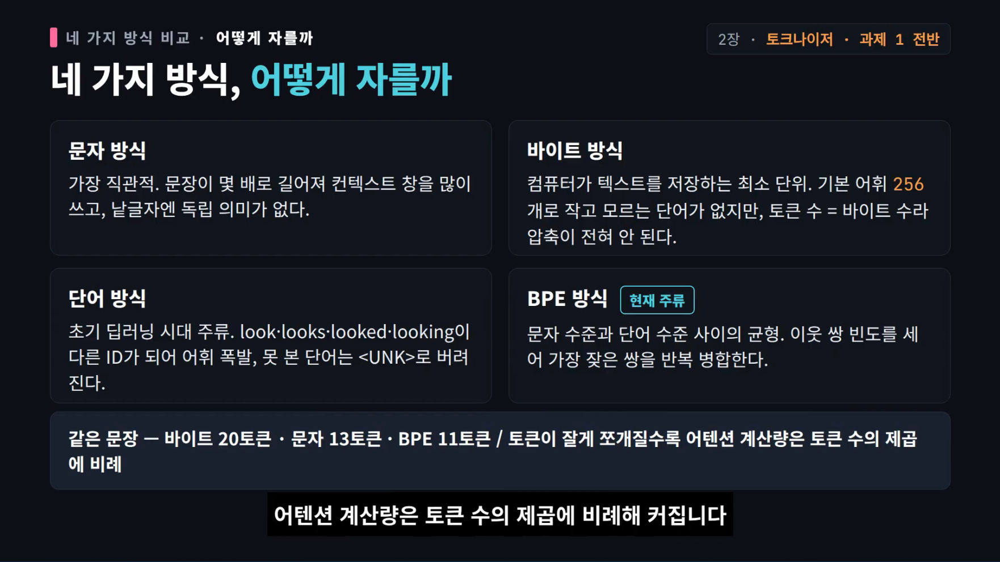
*[2장 · 9:19](https://youtu.be/3CGzbslfy0Y?t=559) — 같은 문장이 바이트 20토큰 · 문자 13토큰 · BPE 11토큰. 토큰이 잘게 쪼개질수록 어텐션 계산량이 토큰 수의 제곱(`O(N²D)`)으로 커진다.*

### 2.2 BPE의 원리와 학습 절차

BPE(Byte Pair Encoding)는 **말뭉치에서 이웃한 쌍의 빈도를 세어 가장 자주 나온 쌍을 하나로 합치는 일을 반복**한다. 빈도만 보는 탐욕적 규칙이지만, 자주 나온 조합은 긴 토큰이 되고 드문 조합은 작은 조각으로 남아 자연스럽게 균형이 잡힌다.

```python
# BPE 학습의 본질 (개념 의사코드)
vocab   = {b: i for i, b in enumerate(byte_alphabet)}   # 256개 기본 단위
merges  = []
for _ in range(num_merges):
    pairs = Counter(zip(w[:-1], w[1:]) for w in corpus)   # 인접 쌍 빈도
    a, b  = pairs.most_common(1)[0][0]                    # 가장 흔한 쌍
    vocab[(a, b)] = len(vocab)                            # 새 토큰 ID
    merges.append((a, b))
    corpus = apply_merge(corpus, (a, b))                  # 말뭉치 내 모든 a,b 치환
save({"vocab": vocab, "merges": merges})                  # 두 파일이 함께 있어야 encode/decode가 맞물린다
```

학습은 네 단계로 정리된다: ① 말뭉치 준비 ② 기본 단위 결정 ③ 통계·병합 반복 ④ **어휘 파일 + 병합 규칙 파일** 내보내기.

작은 장치들이 성능과 복원 가능성을 좌우한다.

- **단어 끝 표식(word-end)**: 단어 경계를 표시하지 않으면 경계를 넘어 병합되어 디코딩 때 원문 단어를 복원할 수 없다(`</w>` · `Ġ` · `▁` 같은 표식).
- **사전 분할(pre-tokenization)**: 병합 전에 텍스트를 기본 단위로 나눈다. ① 공백·구두점 기준 ② 유니코드 범주 기준 ③ **바이트 수준**. 바이트 수준은 어떤 문자도 빠짐없이 다루지만 가장 잘게 쪼개는 출발점이라 압축에 더 많은 병합이 필요하다.
- **유니코드 vs UTF-8**: 유니코드는 문자에 고유 번호를 부여하는 표준, UTF-8은 그 번호를 바이트 열로 저장하는 형식. 영문 1바이트, 중문자 보통 3바이트. 이 구분이 "바이트 20 vs 문자 13"의 출처다.
- **정규화**: 같은 문자의 서로 다른 표현을 하나로. 과제 노트북은 **NFKC**를 쓴다.
- **특수 토큰은 병합 대상에서 제외**해 고정해야 숫자 열을 원문으로 정확히 되돌릴 수 있다.

### 2.3 다국어 불균형과 개인정보

중문 200 GB, 영문 150 GB, 불문 10 GB, 한문 5 GB를 그대로 섞으면 통계가 중문·영문에 지배되어 불문·한문의 흔한 문자열이 어휘 공간을 차지하지 못하고 **과도하게 쪼개진다**. 본문이 드는 전략은 비율을 4:4:1:1로 조정하거나 균등하게 맞추는 것. 또 이름·전화번호·이메일은 익명화하는데, **규칙으로 확실히 잡히는 전화번호·이메일을 먼저, 형태가 다양한 이름을 나중에** 처리한다. 익명화는 한 번만 등장하는 정보를 줄여 통계 패턴에 집중하게 돕지만, 과하면 개체 인식 신호를 약화시킨다. 검증용 말뭉치는 본문 예시 기준 99:1로 남긴다.

### 2.4 다른 알고리즘들 — 무엇이 다른가

| 알고리즘 | 자르는 기준 | 한 줄 정리 |
| --- | --- | --- |
| BPE | 인접 쌍의 **빈도** | 탐욕적 병합, 가장 널리 쓰임 |
| WordPiece | 병합 시 **말뭉치 가능도(likelihood) 개선** | "함께 나올 확률 ÷ 독립 확률"이 클수록 합칠 가치. (본문도 이 점수식은 구글 공식이 아니라 HuggingFace 원리 소개의 근사식임을 밝힌다) |
| Unigram | 큰 어휘에서 시작해 **확률 추정 후 저확률 토큰 제거** | 매 회 하위 10~20%를 덜어내 목표 크기까지 |
| SentencePiece | 알고리즘이 아닌 **프레임워크** | BPE/Unigram을 담고, 공백을 `▁`로 인코딩해 공백 자체를 어휘 대상으로 삼는다 |

좋은 토크나이저의 판정 기준도 여기서 나온다: **평균 토큰 수**(압축률), **핵심 용어 과분할 여부**, **언어별 토큰 균형**을 검증 셋으로 확인하는 것.

### 2.5 실물 분석 — DeepSeek Coder 6.7B 토크나이저

- 대상: DeepSeek Coder 6.7B Instruct의 공식 토크나이저. 최적화된 바이트 수준 BPE 어휘가 중문 단어 분포와 **코드 들여쓰기**까지 세밀히 모델링해 토큰 시퀀스를 줄이고 추론 처리량을 높인다고 본문은 설명한다.
- 관찰 1: **단독 공백 토큰의 ID가 위치와 무관하게 모두 223**. 즉 토큰↔ID 대응표에는 위치 정보가 없다.
- 관찰 2: DeepSeek이 **Latin-1 원 인코딩**을 쓰는 이유 — 바이트를 문자처럼 병합하려면 어떤 바이트 열도 손실 없이 보존되어야 하는데, Latin-1은 각 바이트를 문자에 1:1로 대응시켜 그 조건을 만족한다.
- 분할 결과가 깨져 보여도 반드시 인코딩 오류는 아니다. 어휘가 특정 문자·조각을 충분히 포괄하지 못하면 그렇게 보이며, 해법은 말뭉치 확대 또는 BPE 학습량 증대다.

### 2.6 과제 1과의 연결 — 실제 산출물

| 항목 | 값 |
| --- | --- |
| 라이브러리 | HuggingFace `tokenizers` (BPE를 손으로 구현하지 않음) |
| 정규화 | NFKC |
| 사전 분할 | byte-level (단어 합·공백 포함) |
| 특수 토큰 | 5개(BOS·EOS·UNK·PAD 등) |
| 어휘 크기 | 52,557 |
| 병합 규칙 수 | 50,074 |
| 학습 데이터 | TinyStories를 1 MB 단위로 읽음 |

산출물 `tokenizer.json` 하나로 다음 단계가 **80만 개 샘플**을 뽑아 학습용 바이너리 데이터를 만들고 미니 트랜스포머를 학습한다. 즉 이 장의 토크나이저가 모델의 입구가 된다. 그리고 마지막 문장이 중요하다: **토크나이저는 표현을 다듬을 뿐, 언어 이해는 이후 트랜스포머 학습에서 얻어진다.**

---

## 3장 · 계산 먼저 — PyTorch와 자원 계산 (0:15:17)

**한 줄 요지: 코드를 짜기 전에 종이 위에서 계산하라. `6ND`와 "파라미터당 약 16바이트"만 외워도 대부분의 상사 질문에 답할 수 있다.**

### 3.1 두 장면 — 냅킨 수학이 필요한 이유

**장면 1.** "H100 1,024장으로 70B 모델을 15조 토큰으로 학습하면 얼마나 걸릴까?" 코드로 재려면 며칠~몇 달. 종이 한 장으로 답한다.

```
총 계산량 C = 6 × N × D
            = 6 × 7.0e10 × 1.5e13 = 6.3e24 FLOPs
        (순전파 2ND + 역전파 4ND = 6ND: 파라미터당 순전파 2, 역전파 4)

H100 BF16 피크  ≈ 1,979 TFLOPS (구조적 희소성 켠 이론값)
밀집 학습 실효   ≈   990 TFLOPS (절반)
MFU(모델 FLOPs 활용률) 30~60% → 50% 가정 ⇒ 유효 5e14 FLOP/s per GPU
1,024장 합계     = 5e17 FLOP/s

시간 = 6.3e24 / 5e17 = 1.26e7 s ≈ 146일  (중단 없이 돌린다는 가정)
```

**장면 2.** "80 GB H100 8장 = 640 GB니까 FP32로 1,600억 파라미터까지 되나?" **틀렸다.** 학습 중에는 파라미터만 있지 않다.

```
파라미터(FP32) 4 B + 그레이디언트 4 B + AdamW 상태 8 B (1차·2차 모멘트)
= 파라미터당 약 16 B
640 GB / 16 B = 4.0e10  → 최대 400억 파라미터 (활성화 메모리 제외, 이론 상한)
```

AdamW의 상태는 그레이디언트와 그레이디언트 제곱의 **지수 이동 평균** 두 개다. 이것이 "가중치 사본 다섯 개 분량"이라는 8장의 표현과 같은 뿌리다.

### 3.2 정밀도 — 무엇을 낮추고 무엇을 지키는가

| 형식 | 바이트 | 비트 구성 | 특징 |
| --- | --- | --- | --- |
| FP32 | 4 | 부호1·지수8·가수23 | PyTorch 기본, 가장 안정, 대형 모델엔 사치. **GPU가 FP32를 거의 최적화하지 않아 매우 느리다** |
| FP16 | 2 | 지수 5 | 동적 범위 좁음 → `1e-8`이 0으로 언더플로, 손실 스케일링 필요(V100 세대 주류) |
| **BF16** | 2 | 지수 **8** (FP32와 동일) | 범위를 그대로 가져오고 가수만 줄임 → 손실 스케일링 불필요, **현재 LLM 학습의 절대 주류** |
| FP8 | 1 | E4M3 / E5M2 | H100 이상 네이티브, 현재는 주로 추론 양자화. FP8 학습은 불안정한 최전선 |
| NVFP4 | 0.5 | 블록 공유 스케일 | 2025년 NVIDIA. 블록 단위 스케일로 4비트 이상의 범위를 얻지만 "이웃 값 하나는 크고 하나는 작게"는 불가. 2026년 Nemotron 3 Super가 NVFP4 학습 모델로 소개됨 |

**혼합 정밀도(AMP)의 원리**: 소모가 크고 정밀도에 관대한 부분(행렬 곱)은 BF16/FP8, 정밀도에 민감한 부분(파라미터·그레이디언트·옵티마이저 상태, 지수·소프트맥스)은 FP32. PyTorch AMP가 안전/위험 연산을 자동으로 갈라준다.

### 3.3 학습 스텝을 자원 관점으로 다시 쓰기

```python
for batch in loader:
    opt.zero_grad(set_to_none=True)   # 포인터를 None으로 (0으로 채우는 것보다 메모리 효율적)
    loss = model(batch).loss          # 순전파: 활성화 저장
    loss.backward()                   # 역전파: 그레이디언트 누적
    opt.step()                        # AdamW 업데이트
```

- **메모리 4요소**: 파라미터 + 활성화 + 그레이디언트 + 옵티마이저 상태. 전부 FP32면 `총량 = (W + A + G + O) × 4`.
- **계산량**: 한 스텝 `≈ 6 × B × N`(배치 토큰 수 기준). 실제 트랜스포머는 어텐션 항 때문에 더 복잡하다.
- **연산 강도(arithmetic intensity)** = 메모리 접근 1바이트당 FLOPs. H100의 가속기 강도 ≈ **295 FLOP/byte**.
  - ReLU ≈ 0.25, GEMV ≈ 1 → **메모리 바운드**
  - GEMM ≈ 340 → **계산 바운드**
  - 활용률 ≈ `min(1, 2 × AI / 가속기강도)` — "가속기 강도로 나눈 값에 최대 2를 씌운 것"이 본문의 근사이며, 이것이 실측 활용률이 0.5 안팎인 이유다.
  - 결론: **학습은 전체 시퀀스를 GEMM으로 처리해 계산 바운드, 추론은 토큰 하나씩 GEMV로 처리해 메모리 바운드.** 추론 활용률이 학습보다 낮은 이유가 여기 있다(10장으로 이어짐).
- **체크포인트는 필수**이며, 모델 파라미터뿐 아니라 **옵티마이저 상태까지** 저장해야 중단 지점에서 제대로 재개된다.

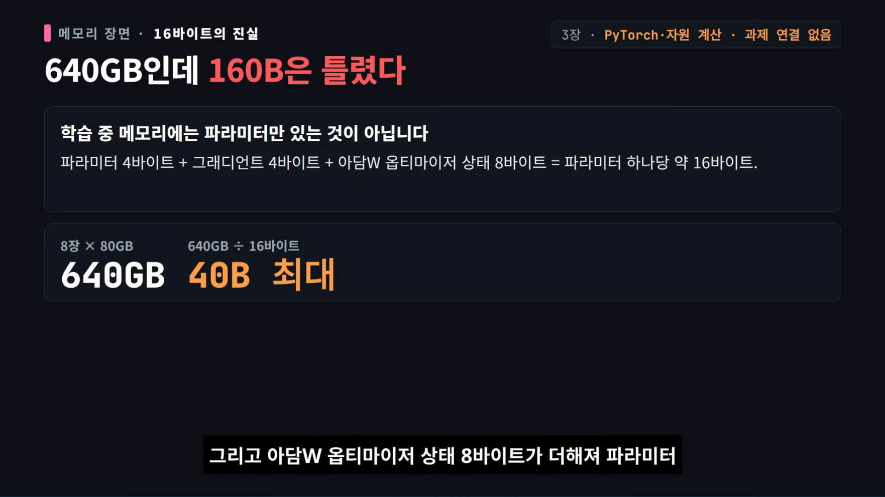
*[3장 · 17:37](https://youtu.be/3CGzbslfy0Y?t=1057) — "FP32 4바이트니까 1,600억"이 틀린 이유. 파라미터 4 + 그레이디언트 4 + AdamW 상태 8 = 16 B/param.*

---

## 4장 · 언어 모델 아키텍처와 학습 세부 (0:22:37)

**한 줄 요지: 뼈대는 2017년 그대로다. 바뀐 것은 네 군데 — 위치(RoPE), 정규화(Pre-Norm·RMSNorm), 활성화(SwiGLU), 학습(AdamW + 코사인/가중치 감쇠)다.**

### 4.1 표준형 복습 (2017, "Attention Is All You Need")

| 요소 | 원 설계 |
| --- | --- |
| 위치 정보 | 사인·코사인 위치 인코딩(짝수 차원 sin, 홀수 차원 cos), 학습 파라미터 없음 |
| 어텐션 | 8헤드 병렬 |
| 차원 | `d_model=512`, `d_head=64`, FFN 내부 2048(4배) |
| 정규화 | **Post-Norm** (잔차 합 뒤) |

### 4.2 바뀐 것 ① — RoPE (회전 위치 인코딩)

2021년 제안, 2023년경 분야가 사실상 수렴. 아이디어는 한 문장이다: **쿼리·키 벡터를 위치만큼 회전시킨 뒤 내적하면, 그 값은 절대 위치가 아니라 두 토큰의 상대 거리에만 의존한다.**

```
q'_m = R(θ, m) q_m ,  k'_n = R(θ, n) k_n
q'_m · k'_n = f(m − n)            # 상대 거리만 남는다
θ_i = base^(−2i/d)                # 차원마다 다른 회전 속도 → 가까운/먼 거리 동시 표현
```

- 추가 파라미터 0, 어텐션 층 **내부**에서 동작, 위치를 더하는 게 아니라 회전으로 상대 거리를 새긴다.
- 그래서 위치 임베딩 테이블이 사라지고, 토큰 임베딩은 순수한 "ID→벡터 lookup"으로 남는다.

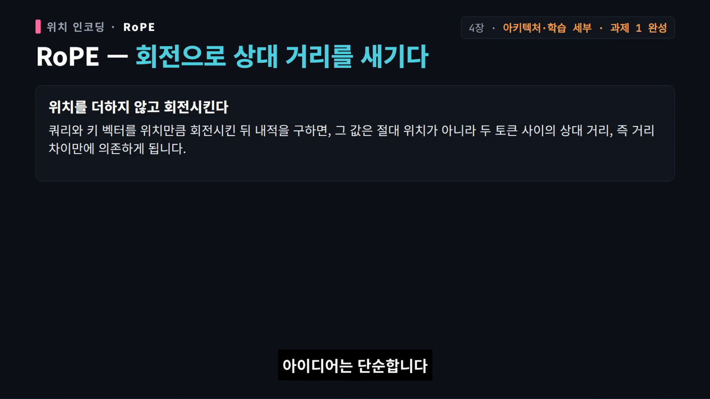
*[4장 · 23:57](https://youtu.be/3CGzbslfy0Y?t=1437) — 절대 위치를 더하는 방식과의 차이.*

### 4.3 바뀐 것 ② — Pre-Norm + RMSNorm

- **Pre-Norm**: 서브레이어 **앞**에 정규화를 둔다. 잔차 스트림이 아래에서 위로 거침없이 흐르는 "고속도로"가 생겨 기울기가 장애물 없이 지나간다 → 100층 넘는 깊은 네트워크도 복잡한 워 warmup 없이 학습된다.
- **RMSNorm**: LayerNorm에서 **평균 빼기를 제거**하고 편향 항도 없앤다.

```
LayerNorm(x) = (x − μ) / σ · γ + β
RMSNorm(x)   = x / sqrt(mean(x²) + ε) · γ        # μ 제거, β 제거
```

성능 손실은 거의 없고 속도가 붙는다. 본문 실험: **초당 3.5 스텝 → 3.68 스텝, 최종 손실도 더 낮음.**

### 4.4 바뀐 것 ③ — SwiGLU (게이트 FFN)

내용 채널과 게이트 채널 두 갈래로 나눈다. 한쪽은 정보를 그대로 전달하고, 다른 쪽은 0~1 스위치로 토큰마다 통과량을 조절한다.

```
SwiGLU(x) = (x W₁ ⊙ swish(x W_gate)) W₂
```

- **필수는 아니다.** GPT-3는 게이트를 쓰지 않았고, Nemotron-340B(ReLU)와 Falcon-211B(ReLU)도 높은 성능을 냈다. "일관된 이득을 주는 선택지"이지 절대 조건이 아니다.
- FFN 확장 비율 관습: ReLU 계열 **4×**, 게이트 계열 **약 2.66×**(파라미터 수를 4× ReLU와 맞추기 위해). T5는 한때 64×라는 과감한 설정을 썼고, 뒤집어 보면 **1×~10×가 넓은 최적 구간**이라는 연구도 있다.
- 헤드 수 × 헤드 차원 ≈ `d_model`. 층마다 약 128차원, 너비:깊이 ≈ 100 부근에서 손실이 가장 낮다는 결과.
- 어휘 크기: 초기 3만~5만 → 다언어 실전 모델 10만~20만.

### 4.5 바뀐 것 ④ — AdamW와 스케줄

```python
# 과제 1 완성 코드의 하이퍼파라미터(4장 본문이 아니라 과제 코드 기본값)
betas = (0.9, 0.95);  lr = 3e-4;  min_lr = 3e-5
warmup = 0.10 * total_steps          # 전체의 10% 선형 웜업
# 이후 코사인 곡선으로 min_lr까지 감소
```

- AdamW는 1차·2차 모멘트로 적응적 학습을 하면서, **가중치 감쇠를 기울기 업데이트와 분리**해 적용한다.
- **역설**: 사전학습은 보통 1 에포크라 과적합이 거의 없는데 가중치 감쇠를 왜 쓰나? 본문의 답은 과적합 방지가 아니라, **코사인 감소 말미에 학습률이 0에 가까워질 때 가중치 감쇠가 최적화 동역학과 얽혀 암묵적 가속을 일으켜 최종 손실을 낮춘다**는 것.
- 안정성 장치: 출력 소프트맥스의 z-loss(분모를 1 근처로 묶는 항, PaLM 계수 `1e-4`), 어텐션 내부 **QK-Norm**, 로짓을 상한 30으로 부드럽게 묶는 소프트 클리핑(단 **한 실험에서 기준 ppl 11.19보다 오히려 나빠진 반증**이 있으니 무조건 좋은 기법은 아니다).

### 4.6 과제 1의 소거(ablation) 실험

| 항목 | 값 |
| --- | --- |
| 미니 모델 | `d_model=256`, 6층, 8헤드, 컨텍스트 128 |
| 데이터 | TinyStories |
| 원본 구성 | Pre-Norm + RMSNorm + SwiGLU |
| 실험 1 | 블록 내부 정규화 제거(최종 출력 앞 정규화는 유지 → "정규화 전부 제거"가 아님) |
| 실험 2 | Post-Norm으로 이동 |
| 실험 3 | SwiGLU → 게이트 없는 ReLU |
| 결과 | 학습/검증 퍼플렉시티 곡선 그래프로 공개. **최종 수치는 텍스트로 공개되지 않아 영상도 단정하지 않는다** |

퍼플렉시티는 "다음 토큰을 얼마나 헷갈리는가"이며 낮을수록 좋다. 이 과제의 맛은 **곡선의 모양**을 직접 대조하는 것이다.

---

## 5장 · 어텐션 개선과 MoE — 전문가를 나눠 쓰는 확장 (0:29:44)

**한 줄 요지: MoE는 "파라미터와 계산량을 분리"하는 조건부 계산이다. 계산은 그대로 두고 용량을 키우며, 진짜 어려움은 라우팅의 부하 균형과 안정성에 있다.**

### 5.1 표준 어텐션의 비용과 두 갈래 경량화

표준 어텐션은 모든 쌍을 비교하므로 `O(N²D)`.

1. **하이브리드 어텐션**: 일부 층은 표준(전체 문맥 정밀), 다른 층은 **선형 어텐션**(과거를 고정 크기 상태로 압축, 추론 계산량 `O(ND)` 수준). Kimi Linear 설정에서 선형:표준 ≈ **3:1**이 가장 좋은 균형이었지만 보편 비율은 아니다.
2. **희소 어텐션(DeepSeek)**: 가벼운 인덱서가 질의마다 관련 있는 키 상위 `k`개만 골라 정식 어텐션을 계산 → `O(Nk)`.

### 5.2 MoE의 계산 구조

```
h(x) = x · W_g                       # 라우터: 토큰 → 전문가별 점수 (E개)
p    = softmax(TopK(h(x)))           # 상위 k만 남기고 나머지 0
y    = Σ_{i∈TopK} p_i · Expert_i(x)  # 선택된 전문가 출력의 가중 합
```

- **희소 활성화**: 전체 파라미터는 거대하지만 토큰 하나는 top-1/top-2만 깨운다. 계산량은 대략 그대로, 용량은 크게.
- **단서**: MoE의 이점은 **큰 규모 + 충분한 데이터 + 충분한 연산**에서 두드러지고, 작은 규모나 자원 부족 환경에서는 조밀(dense) 모델보다 못할 수 있다.

| 라우팅 방식 | 선택 주체 | 장점 | 대가 |
| --- | --- | --- | --- |
| 토큰 선택(token-choice) | 토큰이 top-k 전문가 선택 | 모든 토큰이 배정됨 → 의미 누락 위험 낮음 | 인기 전문가에 몰림 |
| 전문가 선택(expert-choice) | 전문가가 top-k 토큰 선택 | 전문가별 처리량 상한 → 부하 균형 유리 | 선택받지 못한 토큰은 통째로 탈락 |

**부하 불균형을 다스리는 다섯 가지**: ① 보조 손실(전문가별 토큰 수·라우팅 확률 균등화) ② 용량 제한(capacity factor, 초과분은 탈락 또는 우회) — Switch Transformer는 top-1 + 초과 토큰을 잔차로만 통과시키며 **그 토큰은 해당 전문가의 기울기를 얻지 못한다** ③ 무손실 동적 균형(추가 손실 없이 과거 부하 통계 기반 바이어스로 점수 미세 조정) ④ 공유 전문가(모든 토큰이 항상 거치는 공통 지식 담당) ⑤ 학습 없는 해시 라우팅(균형은 좋지만 유연성 상실).

**업사이클링 vs 처음부터 학습**: 결론이 실험마다 다르다.
- OLMoE 실험(토큰 선택): 처음부터 학습한 MoE가 **약 500억~600억 토큰**에서 업사이클 모델을 따라잡고 추월 → 원본 dense 연산 예산의 **약 25%**.
- 전문가 선택 방식 업사이클링 연구: 따라잡는 데 원본의 **약 120%**가 필요.

### 5.3 DeepSeekMoE — 세분화 + 공유 전문가

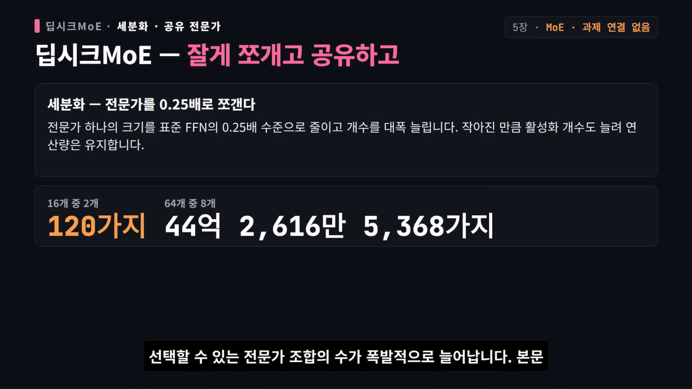
*[5장 · 35:17](https://youtu.be/3CGzbslfy0Y?t=2117) — 16개 중 2개(120가지) vs 4개씩 쪼갠 64개 중 8개(44억 2,616만 5,368가지).*

- **세분화(fine-grained)**: 전문가 하나를 표준 FFN의 **0.25배**로 줄이고 개수를 대폭 늘린다. 작아진 만큼 활성화 개수를 늘려 연산량은 유지 → **선택 가능한 조합 수가 폭발**한다. `C(16,2)=120` vs `C(64,8)=4,426,165,368`.
- **공유 전문가**: 공통 지식의 중복을 줄인다. 절제 실험에서 총 활성 파라미터를 고정한 채 **공유:활성 ≈ 1:3**일 때 성능이 가장 좋았다. 단 세분화를 계속하면 효과가 둔화되고 통신 부담이 커진다.
- **DeepSeek-V3의 실전 장치**:
  - 부하 균형 손실을 **전문가 수준**(전문가 간 토큰 분포)과 **장치 수준**(장치 간 부하) 두 층으로 분리
  - 전문가로 보내는 활성화는 **FP8**로 양자화해 대역폭 절약, 출력 결합 연산은 **BF16** 유지
  - 초반 얕은 층은 학습 가능한 라우터 대신 **3층 해시 MoE**(불안정한 초반 층이 라우터를 흔들지 않게)
  - 손실 스파이크 감지 시 **룩어헤드 라우팅**(직전 단계 라우팅 파라미터로 다음 단계 배정 선계산, 약 **+20% 연산**을 파이프라이닝으로 흡수)
  - SwiGLU 선형 성분을 **[-10, 10]**으로 제한, 게이팅 성분 상한 **10**으로 이상치 억제
  - 본문도 이 기법들이 "이론적 토대보다 실용 검증 단계"라고 밝힌다.

### 5.4 초대규모 사례와 실습

- **Kimi K2**: 총 **약 1.04조** 파라미터, 활성 **약 326억**. 하이브리드 병렬 + **LoRA 샤딩**으로 강화학습을 안정화해 전체 파라미터 RL 대비 GPU 비용을 **약 10% 수준**으로 줄였다고 본문은 전한다(해당 모델·과제·환경 의존, 재현 검증 필요).
- **전문가 병렬**: 전문가를 장치별로 두고 라우터가 토큰을 해당 장치로 보내는 방식(8장 all-to-all).
- 실습: 5장 폴더의 미니 실습 코드는 **어휘 259개**의 작은 모델에서 라우팅·용량 제한·노이즈 게이팅을 실험할 수 있다.

---

## 6장 · GPU와 최적화 (0:37:46)

**한 줄 요지: GPU 최적화는 결국 "메모리 이동을 줄이는 일"이다. FlashAttention은 계산을 줄이지 않고 HBM 왕복을 없앴고, PagedAttention은 KV 캐시의 낭비를 없앴다.**

### 6.1 왜 GPU인가 — 지연 최적화 vs 처리량 최적화

| | CPU | GPU |
| --- | --- | --- |
| 설계 목표 | **지연**(한 작업을 가장 빨리) | **처리량**(전체를 가장 빨리) |
| 칩 면적 | 제어 로직·캐시가 대부분 | 단순 곱셈·덧셈 유닛이 대부분 |
| 코어 | 수십 개 | 수만 개 |

3차원 그래픽이 작은 삼각형 집합이고 중간 픽셀을 저장하지 않고 실시간 계산했던 역사가 "단순 연산 대량 병렬" 장치를 만들었고, 신경망의 핵심인 행렬 연산도 결국 대량의 곱셈·덧셈이라 GPU가 AI의 엔진이 됐다.

### 6.2 실행 모델 — SM·워프·메모리 계층

- 실제 일하는 단위는 **SM(Streaming Multiprocessor)**. A100 기준 **108개**, 각 SM이 수천 스레드 관리.
- 스레드는 **32개씩 워프**로 묶여 같은 명령을 서로 다른 데이터에 적용(**SIMT**). 워프 안에서 조건 분기가 갈리면 **양쪽 경로를 마스크 바꿔가며 직렬 실행** → 워프 분기. **최적화 제1원칙은 워프 안 스레드가 같은 경로를 타게 만드는 것.**
- 메모리 계층(속도·용량은 함께 못 잡는다):

| 계층 | 지연 | 용량 |
| --- | --- | --- |
| 레지스터 | 1 사이클 | SM당 256 KB |
| 공유 메모리 | 20~40 사이클 | SM당 192 KB |
| L2 | ~200 사이클 | 40 MB |
| HBM | ~500 사이클 | 40/80 GB (A100 대역폭 2,039 GB/s) |

- **핵심 격차**: 연산 성능은 수만 배로 뛰었지만 대역폭은 100배 수준. 그래서 **루프라인 모델**(가로: 연산 강도, 세로: 처리량)의 왼쪽(메모리 병목)에 머무르지 않게 하는 것이 최적화의 목표다.

### 6.3 효과 순서대로 보는 최적화

1. **저정밀도 연산** — 가장 큰 효과. FP32→BF16이면 GPT-3(175B) 가중치가 **700 GB → 350 GB**. 2 TB/s에서 FP32는 초당 500억 파라미터, BF16은 1,000억 파라미터를 옮긴다. **텐서 코어**까지 더하면 A100 기준 FP32 19.5 TFLOPS → TF32 156 → FP16/BF16 **312 TFLOPS(16배)**. 표준 혼합 정밀도는 입력 16비트, 부분합 누적 32비트.
2. **연산자 융합** — 연속 연산을 한 커널로 합쳐 중간 결과를 전역 메모리에 쓰지 않는다. 본문 **2~5배**.
3. **재계산(gradient checkpointing)** — 중간값을 저장하지 않고 다시 계산. 3겹 시그모이드 예시에서 메모리 접근 **8회 → 5회**, 대신 재계산 3회. "메모리 병목으로 연산 유닛이 놀고 있다면 남는 연산으로 부족한 대역폭을 산다."
4. **메모리 병합(coalescing)** — 워프 32스레드가 연속 주소를 접근하면 한 번의 전송으로.
5. **타일링** — 행렬을 조각내 공유 메모리에 올려 전역 메모리 읽기를 타일 크기만큼 줄인다.

### 6.4 FlashAttention — "계산이 아니라 왕복이 병목"

표준 어텐션은 `N×N` 어텐션 행렬을 만든다. 병목은 계산이 아니라 **그 행렬을 HBM에 쓰고 읽는 빈도**다.

- **V1**: 계산량은 줄이지 않는다. **타일링 + 온라인 소프트맥스**로 QK곱·소프트맥스 누적을 SRAM 안에서 끝내 `N×N` 행렬을 HBM에 만들지 않는다. **수학적으로 표준 어텐션과 동등(근사 아님)**, 메모리 사용량은 다른 구현의 약 절반.
- **V2**: 한 질의 블록을 KV 차원으로 나눠 여러 스레드 블록이 병렬 처리 후 합산 → 직렬 의존성을 공간 병렬로. A100에서 길이 512~16,000 구간 **V1 대비 평균 1.7~2.0배, 표준 대비 8~10배**, 40 GB 한 장에서 **32,000 길이 학습** 안정.
- **V3**: H100의 비동기 파이프라인으로 데이터 적재와 텐서 코어 계산을 겹침. SM 활용률 **60% → 80% 이상**, FP8 혼합 정밀도로 **V2 FP16 대비 약 1.5~2배**.
- 요약: **V1은 입출력 병목, V2는 병렬 스케줄링, V3는 계산과 메모리 접근의 겹침**을 해결했다.

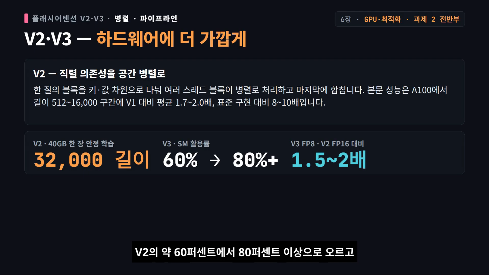
*[6장 · 44:07](https://youtu.be/3CGzbslfy0Y?t=2647) — 수치를 슬라이드로 정리한 장면.*

### 6.5 PagedAttention — 추론 쪽 같은 발상

전통 방식은 요청마다 **최대 길이 기준으로 연속 공간을 예약**한다. 실제 생성 길이를 모르니 빈 공간이 대량 낭비된다. PagedAttention은 KV 캐시를 **16토큰 페이지**로 나누고 **블록 테이블**로 논리 순서와 물리 주소를 분리해 필요할 때만 할당한다.

> 본문 예시: 300토큰 요청 — 최대 길이 2,048 예약 시 **1,748토큰 낭비**, 페이지 방식은 19페이지 할당으로 **낭비 4토큰**.

플래시 어텐션이 "한 번의 순전파를 빨리"라면 페이지드 어텐션은 "전체 생성 과정의 메모리를 효율적으로". 실전 프레임워크는 둘을 함께 쓰되 페이지 단위 비연속 레이아웃에 맞게 커널을 적응시켜야 한다.

### 6.6 과제 2의 전반부

측정(종단 벤치마크·메모리 프로파일링) → PyTorch 어텐션과 JIT 컴파일 어텐션 측정 → **Triton으로 FlashAttention 2 직접 구현**(프로그램 하나가 질의 블록 하나) → 최소 DDP → 기울기 버킷으로 통신 횟수 축소 → 통신과 역전파 겹치기. **분산 학습 전체와 4D 병렬은 8장**이므로 6장에서 과제 2가 끝나지 않는다.

---

## 7장 · GPU 고성능 프로그래밍 (0:46:07)

**한 줄 요지: 최적화 전에 측정하라. 그리고 손으로 커널을 쓰기 전에, 컴파일러가 이미 잘하는 일과 사람만 할 수 있는 일을 구분하라.**

### 7.1 측정 — 벤치마크의 두 함정

1. **워밍업 없이 재면 첫 실행이 느리다**(컴파일·명령 전달 등 초기화 비용).
2. **CPU와 GPU는 독립적으로 움직인다** → `torch.cuda.synchronize()` 없이 시간을 끊으면 GPU 작업이 끝나기 전에 측정이 끝난다.

본문 벤치마크 예시(선형층 + GELU 스택, 차원 256, 4층, 배치 256, 2스텝)에서 기준 **6.2초**, 1회 실행 약 5초. 행렬 곱은 1,024→16,384차원까지 **초선형**으로 늘지만 작은 크기에서는 고정 비용 때문에 거의 늘지 않는다.

프로파일링은 PyTorch 내장 프로파일러로 CPU·GPU 시간을 함께 본다. 2,048차원 행렬 덧셈은 **CPU 1.3 ms, GPU 17 µs** — 한 줄짜리 덧셈도 C++ 인터페이스 계층, 커널 실행 개시, 동기화 비용을 거친다. **커널 이름 자체가 정보**다(라이브러리·타일 크기를 읽을 수 있다). 거리 행렬 계산에서는 GPU 시간의 **78%가 행렬 곱**에 쓰인다고 알려준다 → 최적화 지점이 확정된다.

### 7.2 실행 모델을 코드로 옮길 때의 제약

- 블록 수는 SM 수의 **4배 이상**으로 잡아 워프 전환으로 메모리 지연을 숨긴다.
- 단 레지스터를 많이 쓰면 점유율이 떨어진다. 예: 블록당 128스레드 × 스레드당 160레지스터 = 24,800/블록, SM당 65,536 → 블록 3개(12워프)만 상주, 최대 64대비 **18.75%**.
- 공유 메모리 32뱅크는 같은 시각 뱅크당 하나만 처리 → 같은 뱅크 다른 주소는 **뱅크 충돌**로 직렬화.
- 전역 메모리 128바이트 캐시 라인 안의 연속 접근이 **메모리 병합**으로 한 번에 전송.

### 7.3 커널 융합의 실측 — "연산 횟수가 아니라 데이터 이동 횟수"

GELU(tanh 근사)를 PyTorch 식 그대로 쓰면 덧셈·세제곱·곱셈·tanh마다 커널이 따로 실행돼 데이터가 전역 메모리와 연산 유닛을 반복 왕복한다.

| 구현 | 16,384차원 기준 시간 | 비고 |
| --- | --- | --- |
| 직접 구현(여러 커널) | **8.1 ms** | 프로파일러상 커널 여러 번 호출 |
| 내장 `F.gelu` | **1.1 ms** | 커널 한 번, **7배 이상 차이** |
| CUDA 커널 직접 작성 | **1.8 ms** | 단일 커널이 GPU 시간 100% |
| Triton | **1.848 ms** | 쿠다와 사실상 동일, 파이썬으로 블록 단위 |
| `torch.compile` | **1.47 ms** | 컴파일러가 자동 융합 |

- **CUDA**: 스레드가 맡을 원소 번호를 직접 계산(`blockIdx.x * blockDim.x + threadIdx.x`), 경계 검사, 블록 크기 1024, 블록 수는 올림 나눗셈. 디버깅은 동기 실행 옵션으로 오류 메시지 확인.
- **Triton**(2021, OpenAI): 스레드가 아니라 **블록 단위 사고**. 소프트맥스는 행 하나가 블록에 들어가면 한 블록이 행 전체를, 길면 타일 루프로 부분합 누적 후 마지막에 합산. 행렬 곱은 출력 타일을 블록에 할당하고 K 방향 타일 루프. GELU는 tanh가 없어 지수 함수로 직접 구성.
- **판단 기준**: 단순 연산자 융합이나 GEMM 커널 선택은 컴파일러가 이미 뛰어나다. **플래시 어텐션처럼 하드웨어 특유의 비직관적 최적화**는 컴파일러가 스스로 발견하기 어렵다. → "새 구조 모듈에서 GPU 활용률이 이상적인데 최적화 여지가 보일 때"가 Triton을 쓸 때다.

---

## 8장 · 분산 학습 — 데이터를 나누는 법, 모델을 나누는 법 (0:54:08)

**한 줄 요지: 병렬 전략은 통신 속도 계층이 결정한다. 기계 안(NVLink)은 빠르고 기계 사이(InfiniBand)는 약 8배 느리므로, 큰 통신이 필요한 텐서 병렬은 기계 안에 가둔다.**

### 8.1 출발점과 공통 언어

- DeepSeek **671B**는 테라바이트 단위 메모리를 요구한다 → 다기계 병렬 필수.
- **집합 통신(collective)**: 가장 중요한 연산이 **all-reduce**(모든 장치 값을 합쳐 결과를 모두에게). 통신량 ≈ 데이터 양의 **2배**(약 `2Ψ`).
- **핵심 통찰**: all-reduce = **reduce-scatter + all-gather**. 두 단계 통신량의 합이 정확히 `2Ψ`이므로, **두 단계 사이에 계산을 끼워 넣어도 통신 총량이 늘지 않는다.** 이것이 뒤에 ZeRO 메모리 절감이 "공짜에 가깝게" 성립하는 이유다.

### 8.2 데이터 병렬과 ZeRO

모델을 모든 장치에 복사하고 배치만 나눈 뒤 기울기를 all-reduce. 문제는 메모리 — 파라미터·기울기·옵티마이저 상태를 전부 들고 있어야 한다(3장의 16 B/param).

| 단계 | 나누는 것 | 75억 파라미터 · 64 가속기 예시 |
| --- | --- | --- |
| DP | 없음 | 120 GB |
| ZeRO-1 | 옵티마이저 상태 | 31.4 GB |
| ZeRO-2 | + 기울기 | 16.6 GB |
| ZeRO-3 | + 파라미터 | **1.9 GB** |

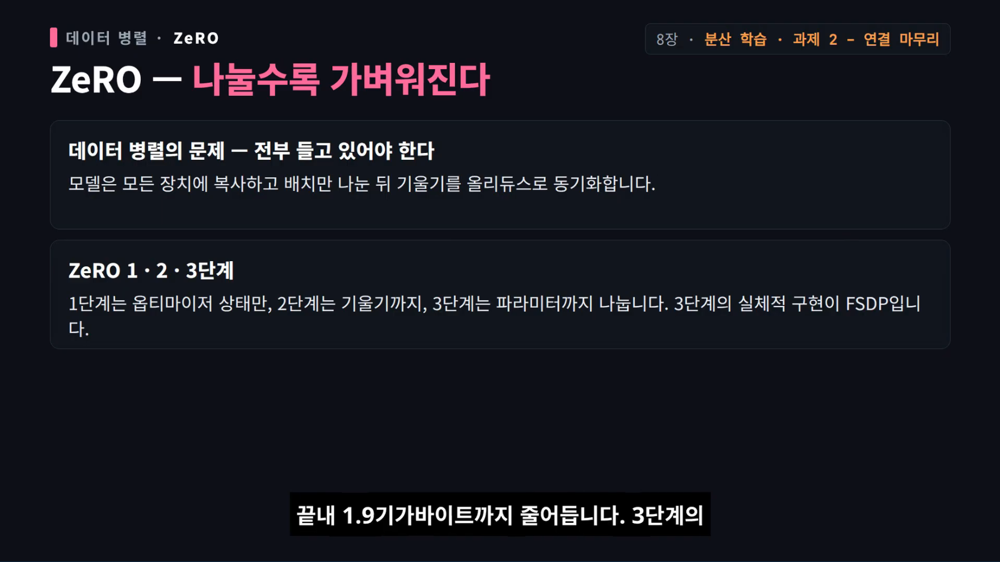
*[8장 · 57:07](https://youtu.be/3CGzbslfy0Y?t=3427) — 같은 75억 파라미터가 120 GB에서 1.9 GB까지 줄어드는 과정.*

- ZeRO-3의 실체적 구현이 **FSDP**(완전 분할 데이터 병렬). 층마다 필요할 때 파라미터를 모아 쓰고 해제하며, 다음 층을 미리 가져오는 겹침 덕분에 **통신량 3배에도 손실은 10~20%**.
- 80 GB 카드 8장 노드: 기존 방식은 **60억** 파라미터가 겨우, ZeRO-3면 **약 500억**까지.
- **근본 한계**: 배치 크기가 자원이다. 전체 배치가 8이면 DP는 8을 넘을 수 없고, 억지로 늘리면 **임계 배치 크기** 벽에 부딪힌다(처음엔 기울기 잡음 감소가 큰 도움이지만, 어느 순간 병목이 잡음이 아니라 **업데이트 횟수 자체**로 바뀐다). 그리고 ZeRO-1/2는 메모리를 확장하지 못하고, ZeRO-3는 활성화 메모리를 줄이지 못한다.

### 8.3 모델을 나누는 세 가지

**① 파이프라인 병렬** — 층 경계로 자르고 활성화를 이웃에 넘긴다. 순진하게 나누면 장치 활용률이 `1/N`로 떨어진다 → **마이크로 배치**로 파이프라인을 채운다(배치 8이면 활용률 급락, 배치 128이면 큰 파이프라인도 높은 활용률). **1F1B**(순방향 1, 역방향 1 교대)는 역방향이 일찍 시작된 만큼 활성화를 일찍 해제한다. 역방향을 **B(활성화 기울기)/W(가중치 기울기)**로 쪼개 의존성 없는 W를 빈틈에 끼우는 **제로 버블(Zero Bubble)** 파이프라인은 기포를 거의 없앤다.

**② 텐서 병렬** — 행렬 곱 자체를 쪼갠다.

```
Y = A·B,   A = [A₁ A₂] (열 분할),  B = [[B₁],[B₂]] (행 분할)
Y = A₁B₁ + A₂B₂  → 각 장치가 부분 결과 → all-reduce로 합산
순방향: f = identity, g = all-reduce   /  역방향: f·g가 뒤집힘
```

기포가 없고 배치도 소모하지 않지만 **통신 비용이 크다**(층마다 잔차 활성화 양의 2배 전송). 그래서 대개 **한 기계 안**에서 쓴다. 본문 그림: 8대까지 **10~12% 손실**, 16대 **42% 저하**, 32대는 그보다 **65% 더** 떨어진다.

**③ 전문가 병렬** — 전문가를 장치에 나눠 배치하고 토큰을 라우팅 결과에 따라 all-to-all로 보낸다. 텐서 병렬이 하나의 행렬을 쪼개 활용률을 떨어뜨리는 데 비해 **전문가 행렬을 통째로 유지**해 계산 효율이 높다. NVIDIA Megatron 안내도 **전문가 병렬을 텐서 병렬보다 우선**하라고 권한다.

**④ 시퀀스 병렬** — LayerNorm·드롭아웃 같은 가벼운 연산의 활성화를 시퀀스 방향으로 나눈다. 순방향 all-gather ↔ 역방향 reduce-scatter의 **쌍대 관계**.

### 8.4 실전 조합 — 경험칙과 실제 배치

경험칙: **모델·활성화가 메모리에 들어간다**는 전제하에 ① 한 기계 안에서는 텐서 병렬 ② 기계를 넘어서는 단계는 ZeRO-3 또는 파이프라인으로 모델을 완전히 올리고 ③ 남은 확장은 데이터 병렬로 채운다.

| 모델 | 병렬 구성 |
| --- | --- |
| DeepSeek-V3 | ZeRO-1 + 파이프라인 16방향 + 전문가 64방향 |
| Llama 3 405B | 텐서 8 · 파이프라인 16 · 데이터 128 (긴 문맥 단계에서 문맥 16방향, 데이터 병렬도 축소) |

### 8.5 과제 2의 마무리

- **버킷 구현**: 기울기를 묶어 통신 횟수를 줄이고, 역전파 계산과 통신을 겹친다.
- **샤딩 옵티마이저**: ZeRO-1의 간소화 버전. 파라미터는 모든 장치가 공유하되 각 장치는 맡은 부분의 옵티마이저 상태만 갖고, 업데이트 뒤 브로드캐스트로 파라미터를 동기화 → 옵티마이저 메모리를 `1/N`.
- 실습 순서: **집합 통신 대역폭 벤치마크** → 단순 MLP로 DP/TP/PP 각각 구현.

---

## 9장 · 스케일링 법칙 — 얼마나 크게, 얼마나 오래 (1:02:42)

**한 줄 요지: 큰 학습은 작은 실험의 외삽으로 설계한다. 데이터는 거듭제곱 법칙을 따르고, 고정 예산에서는 최적 모델 크기가 하나만 존재하며, "20토큰/파라미터"는 출발점일 뿐 결론이 아니다.**

### 9.1 데이터-성능: 거듭제곱 법칙

- 데이터를 늘리면 오차가 거듭제곱으로 줄고, **양쪽 로그 눈금에서 직선**이 되는 것이 그 증거.
- 학습 곡선 3단계: ① 무작위 추측 수준 ② 데이터를 지수적으로 늘리면 오차가 선형으로 줄어드는 **거듭제곱 구간** ③ 아무리 늘려도 줄지 않는 구간. 실전 관심은 ②와 ③ 사이에서 **"데이터 부족인가, 천장인가"를 판정하는 것**.
- 지수는 과제마다 다르다: 기계 번역 **−0.13**, 음성 **−0.3**, 언어 모델 **−0.095**(평균 추측 −1보다 훨씬 느림).
- **데이터 구성은 기울기가 아니라 절편을 바꾼다.** 어떻게 섞든 오차 감소 속도는 같고 직선의 높이만 달라진다(단일 출처 최악, 두 출처 반반이 최선) → **데이터 선택 실험은 작은 모델에서 해도 된다.**
- **반복의 한계**: 약 **4 에포크**까지는 반복 데이터가 새 데이터와 거의 같고, 4를 넘기면 효과가 빠르게 줄어 **약 40 에포크** 부근에서 완전히 평평해진다.
  - 데이터가 부족할 때의 예: 표준 전략 87억 파라미터 · 1,780억 토큰 · 7.1 에포크 → 손실 **2.376** / 데이터 제약 전략 63억 파라미터 · 2,420억 토큰 · 9.7 에포크 → **2.359**. "모델을 조금 줄이고 더 오래"가 약간 낫지만 큰 그림은 못 바꾼다.

### 9.2 모델 크기 × 데이터: Kaplan vs Chinchilla

고정 컴퓨트 예산에서 **최종 모델 크기는 하나**다. 예산이 적은데 큰 모델을 만들면 작은 모델보다 나쁘다(작은 모델은 빨리 좋아지고 빨리 평평해지고, 큰 모델은 느리게 시작해도 컴퓨트를 더 넣으면 추월한다).

| 연구 | 결론 | 지수 |
| --- | --- | --- |
| Kaplan et al. | 컴퓨트가 늘수록 **모델 위주**로 키워라 | `N* ∝ C^0.73`, `D* ∝ C^0.27` |
| Chinchilla | 둘을 **같은 비율**로 늘려라 | 둘 다 ≈ **0.5** → 파라미터당 **약 20토큰** |

Chinchilla 70B(1.4조 토큰)가 더 적은 데이터로 학습한 GPT-3 175B보다 좋았다 → "기존 모델들은 너무 크고 덜 학습됐다"는 평가.

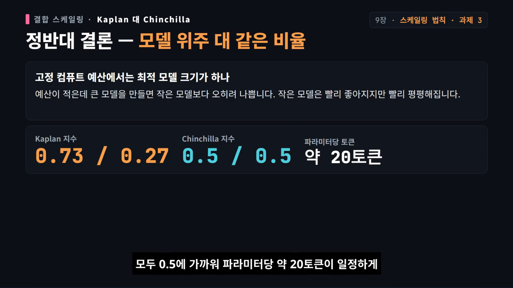
*[9장 · 1:06:07](https://youtu.be/3CGzbslfy0Y?t=3967) — 같은 실험실의 정반대 결론.*

- **IsoFLOPs 분석**: 총 컴퓨트를 고정하고 (모델 크기, 데이터량) 조합을 훑으면 성능 곡선이 **U자**, 바닥이 최적. Chinchilla는 아래쪽 포락선·IsoFLOPs·결합 피팅 **세 방법**으로 같은 결론에 도달했다.
- **왜 Kaplan과 달랐나**: 임베딩 파라미터 집계 여부(표 조회일 뿐이라며 비임베딩만 세는 쪽과 전체를 세는 쪽은 지수가 달라진다), 작은 예산에서의 웜업·학습률 감소 조정. 후속 연구에서 방법 3회에 오류가 있었고 원본 데이터 재피팅 시 다른 두 방법과 일치했다는 보고도 소개된다.

### 9.3 20배 규칙은 결론이 아니다

Chinchilla의 20토큰/파라미터는 **학습 컴퓨트가 고정된 상황의 학습 최적 배분**이다. 실제 배포에서는 **추론 비용이 생애 전체 비용을 지배**하므로, 학습 비용이 더 들더라도 추론이 싼 작은 모델이 유리하다 → **업계는 Chinchilla 비율을 훨씬 넘겨 과학습시키는 추세**다.

| 모델 | 토큰/파라미터 |
| --- | --- |
| GPT-3 | 약 2× |
| Chinchilla | 약 20× |
| Llama 65B | 약 22× |
| Llama 2 70B | 약 29× |
| Mistral 7B | 약 110× |
| Llama 3 70B | 약 215× |

MiniCPM 분석에서는 약 **192배**, 컴퓨트 `1e21`에서 최적 비율 **95.6배**라는 수치도 함께 나온다.

### 9.4 하이퍼파라미터 전이 — μP

모델이 커질수록 최적 학습률은 보통 작아진다. **μP(최대 업데이트 파라미터화)**는 초기화·학습률을 너비에 맞춰 조정해 **최적 학습률을 규모와 무관하게 유지**한다. 목표는 "작은 모델의 학습률을 큰 모델에 그대로 전이".

- Cerebras-GPT: Chinchilla 비율로 **0.1B~13B 일곱 모델** 학습, μP 최초 공개 검증. **4,000만 파라미터에서 찾은 lr 0.006, init std 0.08, embedding scale 10**을 큰 모델에 그대로 적용.
- MiniCPM: 0.04B~2.1B에서 최적 학습률이 **0.01 부근**에 모임.
- DeepSeek: μP 없이 스케일링 법칙을 직접 피팅해 배치·학습률 결정, 소규모 곡선이 **7B·67B 실제 모델과 매우 일치**.

### 9.5 마지막 경고 — ppl만 맞는다

스케일링 법칙은 대개 **퍼플렉시티에만** 적용된다. 컴퓨트-퍼플렉시티는 로그-로그 직선으로 잘 맞지만 **슈퍼글루 같은 하위 과제 정확도와는 선형 관계가 전혀 없다**. 곡선이 좋아졌다고 하위 과제 성능이 같은 비율로 좋아진다고 단정하면 안 된다. 확산 모델도 같은 거듭제곱 법칙을 따른다고 본문은 덧붙인다.

**과제 3**: 70M / 130M / 300M 세 규모를 학습해 IsoFLOPs 곡선을 피팅하고 Chinchilla식으로 최종 손실 예측. 기준은 **파라미터당 최소 20토큰**. 단 이 예측은 비임베딩 파라미터·토큰 수에만 기반하고 다른 하이퍼파라미터는 포함하지 않는다고 과제 안내가 명시한다. IsoFLOPs 데이터는 **예산 9개 × 규모 점 8개**이며, 예산이 커질수록 최소 손실 지점이 큰 모델 쪽으로 이동한다.

---

## 10장 · 왜 느릴까 — 추론, KV 캐시·추측 디코딩·선형 어텐션 (1:10:46)

**한 줄 요지: 학습은 병렬이고 추론은 순차다. 그래서 병목이 연산에서 메모리 대역폭으로 옮겨가고, 모든 최적화는 "매 단계 읽어야 하는 바이트를 줄이는" 방향이다.**

### 10.1 두 조건의 차이

| | 학습 | 추론 |
| --- | --- | --- |
| 입력 | 정답 토큰을 전부 미리 앎 | 방금 만든 토큰이 다음 입력 |
| 병렬성 | 인과 마스크로 전 구간 병렬 계산 | 토큰 사이 순서를 거스를 수 없음 |
| 병목 | **연산량** | **메모리 용량·대역폭** |

### 10.2 지표를 먼저 나눈다

- **TTFT**(첫 토큰까지): 요청 → 첫 토큰. 프리필 속도.
- **ITL**(토큰 간격): 체감 생성 속도.
- **E2E 지연**: 요청 → 마지막 토큰.
- **처리량**: 단위 시간당 시스템이 처리한 토큰 수. **처리량이 높다고 지연이 낮지 않다**(개별 요청은 긴 맥락·대기열로 오래 걸릴 수 있다).
- 참고 수치: OpenAI는 하루 **1,000억 단어** 이상을 생성한다고 공개 언급 → 추론은 일회성 비용이 아니라 **반복되는 지배적 비용**.

### 10.3 프리필과 디코드, KV 캐시

```
프리필: 프롬프트 전체를 한 번에 처리, 각 층·헤드의 K,V를 KV 캐시에 저장   (연산 위주)
디코드: 새 토큰마다 q 하나만 만들어 저장된 K,V와 내적 → 다음 토큰 → 캐시에 K,V 추가
KV 캐시 크기 ∝ 토큰 수 × 층 수 × 어텐션 헤드 수 × 은닉 차원
```

캐시가 없으면 토큰 하나 만들 때마다 옛 토큰을 전부 다시 계산해야 한다. 캐시가 있으면 **매 단계 캐시를 읽는 대역폭**이 속도를 갉아먹는다.

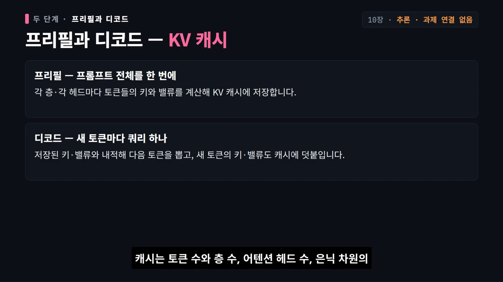
*[10장 · 1:13:07](https://youtu.be/3CGzbslfy0Y?t=4387) — 300토큰 요청이 1,748토큰을 낭비하는 장면.*

### 10.4 연산 강도로 어느 단계가 막히는지 판정

```
MLP 구간:      AI ≈ B·T      → 디코드는 T=1이므로 AI ≈ B(배치). 배치 1이면 AI ≈ 1 → 메모리 바운드
어텐션 구간:   AI ≈ T·S/(T+S) → 디코드 T=1이면 S가 커져도 1로 수렴 → 메모리 바운드
```

즉 **프리필은 연산에 가깝고, 작은 배치의 디코드는 메모리에 막힌다.** 그래서 최적화 방향은 "바이트 줄이기"다: 배치 확대(가중치 읽기를 나눔), **GQA/MQA**(KV 헤드 축소), 양자화(가중치·캐시 바이트 축소, 본문은 INT8/INT4 수준만 언급).

### 10.5 처리량을 올리는 나머지 수단

| 수단 | 내용 | 대가 |
| --- | --- | --- |
| 정적 배치 → **연속 배치(continuous batching)** | 생성 도중 끝난 요청을 빼고 다음 요청을 즉시 삽입 | 배치 키우면 개별 지연 증가 |
| **프롬프트 압축** | 하드(문장·토큰 제거, 재작성) / 소프트(학습된 연속 벡터) / 시각(긴 텍스트를 이미지로, 예: DeepSeek-OCR) | 정보 손실 |
| **SSM/Mamba** | 긴 문맥을 KV 목록으로 쌓지 않고 은닉 상태를 반복 갱신 | KV 캐시 의존 자체를 제거 |
| **선형 어텐션** | 추론은 누적 합 갱신으로 선형 증가(소프트맥스는 제곱) | 세밀 정보 손실. MiniMax는 **선형 7개마다 소프트맥스 1개**(총 80층) 혼합. 9년 지났지만 Llama 3·Qwen2.5·DeepSeek-V3·Mistral은 기본 채택 안 함 |
| **확산 LM** | 블록 내 병렬 복원 + 블록 간 자기회귀 (LLaDA 8B, LLaDA 2.0은 3단계 전환·블록 4096, 2.5-Flash 평균 73.18) | 확신도 높은 토큰부터 확정 → "왜냐하면/따라서" 같은 논리 연결어가 뒤로 밀려 국소적으로 맞고 전체로 어긋남 |
| **추측 디코딩** | 작은 모델이 후보 블록 초안 → 큰 모델이 **한 번의 순전파로 병렬 검증**, 어긋난 지점까지만 수용 | 초안 품질 의존 |
| **캐스케이드 디코딩** | 토큰마다 작은 모델 확신도를 보고 큰 모델 호출 여부 결정 | 블록 단위인 추측 캐스케이드와 다름. Gemma2 2B/27B 비교에서 큰 모델 확률로 수용 판단하는 쪽이 품질·지연 균형 우수 |
| **MTP** | DeepSeek-V3: 앞 단계 표현에서 진화한 표현으로 다음 토큰을 **순차** 예측하는 계단 구조 | **훈련 목표이지 추론 가속 알고리즘 자체는 아님** |

작은 모델이 빠른 이유(본문 간이 계산): 25층·은닉 128·헤드 16·헤드 차원 8·FP8이면 토큰 하나당 은닉 상태 읽기·쓰기가 **3,200바이트**뿐. 실제로는 가중치 읽기와 KV 접근 때문에 훨씬 크다.

**정리**: 어떤 방법도 공짜가 아니다. 배치를 키우면 지연이 늘고, 캐시를 줄이면 정보가 빠지고, 병렬 생성은 인과성을 약화시킨다.

---

## 11장 · 데이터가 답이다 — 데이터 엔지니어링 (1:18:57)

**한 줄 요지: 구조는 복제할 수 있어도 데이터는 복제하기 어렵다. 그래서 파운데이션 모델은 아키텍처·학습법은 공개하면서 데이터 구성에는 침묵한다.**

### 11.1 학습 3단계의 목적 분화

| 단계 | 데이터 | 규모 | 배우는 것 |
| --- | --- | --- | --- |
| 사전학습 | 웹(Common Crawl)·책·위키백과 원시 말뭉치 | 3조~15조 토큰 | 언어 통계·문법·넓은 세상 지식 |
| 중간학습(mid-training) | 엄격히 거른 고품질 텍스트, 수학·코드, 긴 문맥 문서 | 100억~1,000억 토큰 | 추론 숙련도·긴 문맥 |
| 사후학습 | 사람이 만든 지시·다회 대화·선호 피드백 | 수만~수십만 건 | 지시 수행·안전한 대화 |

### 11.2 기준의 진화

- **BERT**: BooksCorpus(약 8억 단어) + 영어 위키백과(약 25억 단어) — 둘 다 긴 문서 단위의 자연스러운 텍스트.
- **GPT-2**: 웹 전체를 긁지 않고 **레딧 추천 3개 이상 링크의 페이지만** 골랐다 → 광고·저품질 차단.
- **GPT-3**: Common Crawl을 끌어오며 중복 제거·태그 제거·잡음 정리를 체계화.
- **The Pile**: arXiv·GitHub·StackExchange 등 **22개 영역**으로 다양성 확장.
- 교훈: 규모만 좇지 말고 **품질 관리와 다양성**을 함께.

### 11.3 최근 모델의 배합

| 모델 | 사전학습 | 중간학습 | 사후학습 |
| --- | --- | --- | --- |
| OLMo 2 | 약 3조 9,000억 토큰, **95% 이상 웹**, 전체 연산의 90~95% | 연산의 5~10%, **상위 7% 고품질 웹** + 커리큘럼, 수학 약 **107억 토큰** | 지시 미세조정 → 선호 정렬 → 검증 가능 보상 RL, SFT에 **약 86만 건** 합성 지시 |
| Qwen 3 | 약 **36조** 토큰(Qwen2.5의 약 2배), **119개 언어·방언** | 약 **5조** 토큰 추가 | 4단계로 맥락 **4,096 → 32,768** |

전문 영역 데이터: **코드**(GitHub, 중복 제거·라이선스 확인·자동 생성/저품질 저장소 필터 → 다단계 추론·문제 분해 능력 향상), **긴 글·서사**(저작권이 분명한 공개 도메인 책), **수학·과학**(arXiv + StackExchange, 수식 파싱·질의응답 정렬).

### 11.4 지뢰밭 세 가지

1. **저작권** — 명시적 표시가 없어도 보호된다. NYT가 OpenAI를 상대로 소송 제기.
2. **데이터 중독(poisoning)** — 공격자가 공개 데이터에 악성 패턴을 심으면 크롤러가 학습에 넣는다. Anthropic·영국 AISI 연구: **모델 크기·데이터 규모와 무관하게 악성 문서 250개로 백도어** 가능.
3. **크롤러 규약(robots.txt) 준수**. 대응책은 정제·필터링, 중요 영역 검토, 학습 뒤 출력 평가.

### 11.5 정제 → 필터링 → 중복 제거

- **규칙 기반(C4 방식)**: HTML 태그 제거 후 **구두점으로 끝나지 않는 단락**, **문장 3개 미만 단락** 폐기. 빠르지만 코드·C 같은 비정형 텍스트를 잘못 버리기 쉽다.
- **퍼플렉시티 필터**: 문법·의미가 맞는 글은 ppl이 낮다. **CCNet**은 언어마다 ppl 분포가 다름에 착안해 언어별 기준을 잡고 **3등분해 가운데만 남긴다**. 단 구어체·희귀 표현 같은 롱테일이 함께 잘린다.
- **모델 기반 필터**: KenLM(엔그램 LM으로 문장 ppl), **fastText**(선형 분류기, 엔그램을 해시 버킷에 매핑·임베딩·평균 후 분류 — 본문 실습에서 "I hate this product"를 부정 99.66%로), **DSIR**(작고 깨끗한 목표 데이터셋 분포에 가까운 샘플을 중요도 재표집; 밀도 비율이 클수록 남길 가치가 큼).
- **중복 제거**: 고빈도 중복은 모델을 암기 기계로 만들고 개인정보 노출 위험을 키운다. 구글 연구팀은 대규모 데이터의 중복·니어듀플리케이트가 흔함을 보고했고, 중복 제거 데이터로 학습하면 같은 계산량에서 ppl이 더 좋아지거나 최소 악화되지 않는다는 연구도 있다.
  - **정확 중복**: 해시 완전 일치
  - **Bloom 필터**: 비트 배열 표시만 남김 — 거짓 양성은 있지만 "나타나지 않았다"는 판단은 확실
  - **MinHash + LSH**: `K`-shingle 집합 → 자카드 유사도 → MinHash 서명 압축 → 밴드 단위로 묶어 후보만 선별(본문 예: 서명 **30밴드 × 2행**, 밴드 하나라도 완전 일치하면 후보)

**과제 4**: Common Crawl에서 HTML 추출 → fastText 언어 식별 → **Gopher 필터**(단어 50개 미만/10만 개 초과 폐기) → 유해 콘텐츠 및 이메일·전화번호·IP 마스킹 → MinHash 중복 제거 → **GPT-2 소형을 20만 번 반복 학습**해 C4 100개 도메인 검증 셋 퍼플렉시티 최소화, 리더보드 제출. 장 말미 질문: "좋은 문서의 실제 모습"과 "의미 수준의 중복 제거".

---

## 12장 · 점수가 다가 아니다 — 평가·벤치마크 (1:27:09)

**한 줄 요지: 평가는 채점이 아니라 설계다. 입력·호출 방식·채점·해석 네 질문을 빼고 점수 하나만 보는 것이 가장 큰 함정이다.**

### 12.1 네 가지 질문 프레임

| 질문 | 내용 |
| --- | --- |
| 입력은 무엇인가 | 프롬프트 출처, 오염 여부 |
| 어떻게 호출하는가 | zero-shot / few-shot / CoT |
| 출력을 어떻게 평가하는가 | 통과율, 사람 심판, LLM 심판 |
| 결과를 어떻게 해석하는가 | 91%가 배포에 충분한가 |

Karpathy는 지금을 **"평가 위기"**라 부른다 — MMLU는 포화됐고 챗봇 아레나는 과적합의 표적이 됐다. 사용자·연구자·정책 입안자·개발자가 서로 다른 것을 묻는다.

### 12.2 지표 계보

- **퍼플렉시티**: 토큰 열에 대한 확률 분포 품질, 낮을수록 좋다. **반드시 보지 못한 테스트 셋에서** 재야 과적합을 놓치지 않는다.
  - 2016 Jozefowicz 팀: 순수 CNN·LSTM으로 10억 단어 벤치마크 **51.3 → 30.0**.
  - GPT-2: 레딧 링크 기반 약 **40 GB** WebText, 표준 셋 zero-shot. **출처가 다른 분포 외 평가에서도 잘했다**는 점이 대규모 데이터의 일반화를 보여줬다.

- **지식 벤치마크**

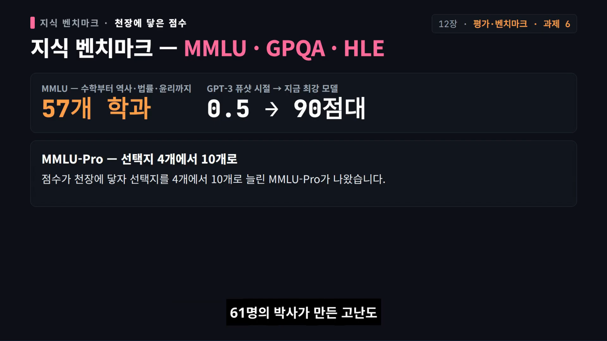
*[12장 · 1:29:47](https://youtu.be/3CGzbslfy0Y?t=5387)*

| 벤치마크 | 구성 | 현재 상태 |
| --- | --- | --- |
| MMLU | 57개 학과 객관식 | GPT-3 시절 최대 모델도 few-shot **0.5 미만** → 지금 최강은 **90점대**, 포화 → MMLU-Pro(선택지 4→10) |
| GPQA | 61명 박사가 만든 고난도 | 전문가 65%, 구글 쓰는 비전문가(30분) 34%, GPT-4 39% → 최신 모델 HELM 기준 **80.3%** |
| HLE(Humanity's Last Exam) | 2,500문항, 상금 50만 달러 | 최신 모델 **38.3%** |
| C-Eval | 중국어 52개 학과 × 4난이도 = **13,948문항**, 법률·의학·자격 포함 | 개발/검증/테스트 분리, 테스트는 공식 제출. 채점은 선택지 조건부 로그 가능도 + 직접 정확률·길이 정규화 정확률. CC BY-NC-SA 4.0 |

- **지시 수행**: Chatbot Arena(익명 블라인드, ELO — 최고 Gemini 3 Pro Preview **1,492**), IFEval(자동 검증 가능 제약, 최첨단 **0.951**), AlpacaEval(805개, 강한 LM 심판), WildBench(100만 건 실대화, GPT-4 Turbo 심판, 아레나와 상관 **0.95**, 정확도 **0.866**).
- **에이전트**: SWE-bench(12개 Python 저장소, **2,294개** 과제, 단위 테스트 통과 PR), Cybench(40개 CTF, 사람에게 24시간 걸리는 과제 포함), MLE-bench(75개 캐글, 최고 모델도 메달 **20% 미만**), ARC-AGI(언어 없이 격자 변환 규칙 추론).
- **안전**: HarmBench(510개 유해 행동, 거부율), AIR-Bench(314개 위험 범주, 5,694개 프롬프트). **거부 학습은 탈옥에 뚫리고**, 자동 최적화된 공격 프롬프트는 오픈 모델에서 폐쇄 모델로 전이될 수 있다. 본문의 질문: **"안전은 거부만이 아니라 능력이다"** — 의료 같은 고위험 장면에서는 환각을 줄이는 것이 안전과 능력을 함께 높인다. 폐쇄 모델은 성향이, 오픈 모델은 능력 자체가 위험이다.
- **유효성(validity)**: ① 학습·테스트 겹침(사전학습이 사실상 인터넷 전체인 시대에는 "본 적 없다"는 보장이 어렵다 → 부풀려진 점수. 해법은 겹침 추론 연구와 제공자의 보고 규범) ② 데이터셋 품질(주석 오류 — **SWE-bench Verified**는 원 점수가 오류 때문에 과소평가됐을 수 있음을 보여줬다).

**과제 6**: 직접 구현이 아니라 **평가 프레임워크 실습**. lm-evaluation-harness로 GPT-2를 CPU에서(상식·코드·수학·C-Eval), EvalScope로 나만의 지수 평가 셋. 실측: **Qwen2.5-0.5B로 C-Eval 검증 1,346문항을 CPU에서 약 5분 → 정확률 0.5134**.

---

## 13장 · 모델을 길들이다 — 사전학습·SFT·RLHF·PPO·DPO (1:35:28)

**한 줄 요지: 사전학습은 압축, SFT는 행동 모방, RLHF는 선호의 대리 목표 최적화, DPO는 그 대리 목표를 보상 모델 없이 직접 푸는 것이다.**

### 13.1 학습 패러다임 구분

| 방식 | 신호 | 언어 모델에서 |
| --- | --- | --- |
| 지도 학습 | 정답 | SFT |
| 비지도 학습 | 없음 | — |
| **자기 지도 학습** | 데이터에서 만든 의사 정답 | **사전학습(다음 토큰 예측)** |
| 강화 학습 | 보상만 | RLHF/RLVR — "학기 말에 최종 성적만 받는 것" |

### 13.2 사전학습

- GPT-1(2018): **5 GB** BooksCorpus로 대규모 비지도 사전학습 후 소량 라벨로 미세조정 — 이 경로를 처음 체계화.
- 패러다임은 **다음 토큰 예측** 하나. 규모: Llama-3-8B **36조** 토큰, 현재 배포 모델 보통 **50조~200조**.
- **GPT-3**(2020-07): 파라미터 **1,750억**, 약 **570 GB** 텍스트. GPT-2 15억에서 **약 100배**. 프롬프팅만으로 번역·QA·산수·코드 완성의 **창발**. 본문 표: 영어 독해 86.8%(인간 평균 73%), 번역 BLEU 43.9, 산수는 예시를 주자 0%→80%, 코드 완성 통과율 37%. 하지만 환각과 편향이 심해 "대단하지만 아직 실용적이지 않았다".

### 13.3 SFT — 지도 미세조정

| 형식 | 구조 | 손실 |
| --- | --- | --- |
| Alpaca | 단일 턴 JSONL(`instruction`, `input`, `output`) | **출력 부분만** |
| ChatML | 다중 턴, 역할별 메시지 누적 | **어시스턴트 토큰만** |

- 규모는 **1만~10만 건**이면 충분. 핵심은 **양보다 질**: 답안이 깨끗하고 안전하며 스타일이 일관돼야 한다.
- **s1 사례**(2025, Pay-by-Example): 고품질 추론 샘플 **1,000개**로 Qwen2.5-32B-Instruct를 **16×H100, 26분, 약 50달러**로 미세조정 → 수학 벤치마크에서 o1-preview와 대등하거나 약간 앞섬. "1,000개의 고품질 시범 > 수만 개 일반 주석".
- MergeKit 연구: **6,000개** 지시로 Llama 7B가 **65,000개** 전체 학습과 대등.
- 라벨 품질의 정량: **라벨이 1% 뒤집힐 때마다 F1이 약 2~5% 하락**, 20%를 넘으면 대부분 분류기가 "찍기"보다 못해진다.
- **함정 — 환각**: 발췌문→인용 포함 답변으로 미세조정하면 ① 타당한 지식 학습과 ② **"개념을 만나면 인용을 덧붙이는 조건 반사"**가 동시에 일어난다. 모델이 그 인용을 몰랐다면 배우는 것은 **인용을 지어내는 행동**뿐이다(John Schulman의 지적). 경험칙: **SFT에서 모르는 사실을 억지로 출력하게 하지 말 것.** 안전도 마찬가지로 **500개 예시**만으로 기본 안전 지침을 따르게 할 수 있다.

### 13.4 RLHF — 3단계

1. **SFT**로 기준 정책
2. **보상 모델** 학습 — SFT 모델 재사용, 최상위 헤드만 선형 층으로 교체. 같은 프롬프트의 두 응답을 비교하는 **쌍별 피드백**
3. **PPO**로 강화학습 미세조정

성능 상한은 **선호 데이터 품질**에 좌우된다. InstructGPT는 약 **40명** 주석자, 질문 하나에 **약 1분**, **유용성·진실성·무해성** 세 축. 주석자 배경이 모델 행동을 그대로 믿는다(주로 필리핀·방글라데시·미국 서부 해안).

**PPO**(2017, OpenAI): 정책 업데이트가 기존 정책에서 너무 멀리 벗어나지 않게 **확률 비율을 클리핑**.

```
r_t(θ) = π_θ(a_t|s_t) / π_θold(a_t|s_t)
L = E[ min( r_t Â_t ,  clip(r_t, 1−ε, 1+ε) Â_t ) ]
ε: 0.1~0.2 · KL 계수 0.01~0.1 · 업데이트 에포크 4~10 · lr 1e-6~5e-5
```

여기에 **중요도 샘플링**(옛 데이터 재사용)과 **어드밴티지**(행동이 평균보다 얼마나 나은가)가 붙는다.

### 13.5 DPO — 직접 선호 최적화

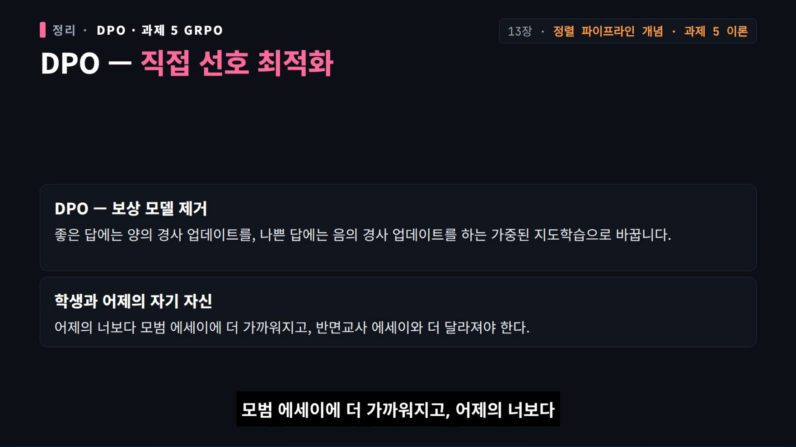
*[13장 · 1:43:07](https://youtu.be/3CGzbslfy0Y?t=6187) — "어제의 나"를 참조 모델로 두는 비유가 슬라이드에 그대로 나온다.*

- 보상 모델을 없애고 중요도 비율 같은 정책 최적화 장치를 전부 제거. **좋은 답에는 양의 경사, 나쁜 답에는 음의 경사**를 주는 **가중된 지도 학습**으로 바꾼다.
- 비유: 모델 = 학생, 참조 모델 = **어제의 자기 자신**. "어제의 너보다 모범 에세이에 가까워지고, 어제의 너보다 반면교사 에세이와 더 달라져야 한다."
- 변형: **cDPO**(참조 모델 제거), **길이 정규화 DPO**(토큰당 평균 확률로 비교).
- 경고: RL 발견은 **환경 의존적**이므로 단일 논문 결과를 교리로 삼지 말 것. 과최적화·모드 붕괴·캘리브레이션 저하의 부작용.

**과제 5**: SFT + 전문가 반복 + GRPO를 **Qwen2.5-Math-1.5B**로 직접 수행. **80 GB GPU 1장 최소, 전체 실험은 2장 권장.**

---

## 14장 · 정답이면 1점 — RLVR·GRPO (1:43:50)

**한 줄 요지: RLHF는 대리 목표(인간 선호)를 최적화한다. 정답을 프로그램이 판정할 수 있는 과제라면 진짜 목표를 직접 최적화하라 — 그 엔진이 GRPO다.**

### 14.1 RLHF의 세 가지 근본 문제

1. **보상 노이즈** — 인간 판단은 주관적·비일관적이고 표면 수사에 속는다.
2. **확장 불가** — 고품질 선호 데이터 비용이 조 단위 토큰 학습을 못 받친다.
3. **과최적화** — 보상 모델을 기쁘게 하는 법을 배워 **그럴듯하지만 속이 빈 답**을 만든다.

### 14.2 RLVR — 검증 가능한 보상

알파고(승패 0/1)·알파폴드(예측-실제 구조 거리)의 공통점은 **보상이 명시적·검증 가능·자동 계산**이라는 것. 언어 모델로 옮기면: 수학은 표준 정답 일치, 코드는 테스트 통과, 형식 증명은 논리 일관성. **보상은 정답 1 / 오답 0**(세분화하면 단계별 과정 보상).

### 14.3 PPO에서 GRPO로 — 가치 모델을 내려놓기

- 정책 경사는 이론적으로 맞지만 분산이 크고 불안정 → **TRPO**는 KL로 정책 변화를 명시 제한(안정적, 구현 극복 어려움) → **PPO**는 클리핑으로 그 사이를 택함.
- PPO의 무거운 짐: 어드밴티지를 위해 **정책과 같은 규모의 가치 모델(critic)**을 따로 학습하고, 실전에서는 **GAE**로 근사.
- **GRPO**(DeepSeekMath 제안, DeepSeek-R1으로 유명): 가치 모델을 없애고 **그룹 상대** 어드밴티지를 쓴다.

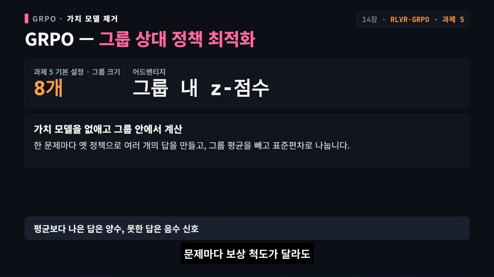
*[14장 · 1:47:37](https://youtu.be/3CGzbslfy0Y?t=6457) — 한 문제에 8개 답을 뽑아 평균·표준편차로 정규화. 과제 5의 기본 그룹 크기도 8.*

```
한 문제 q에 대해 옛 정책으로 G개 응답 {o_1..o_G} 샘플링 (과제 5 기본 G=8)
각 응답을 프로그램으로 채점 → r_i ∈ {0,1}
Â_i = (r_i − mean(r)) / std(r)              # 그룹 내 Z점수
L = E[ min(r_t Â_i, clip(r_t,1−ε,1+ε) Â_i) ] − β·KL(π_θ ‖ π_ref)
```

- 그룹 안에서 비교하므로 **문제마다 보상 척도가 달라도 공정**하다. 본문 요약: "GRPO = PPO에서 가치 모델을 빼고 그룹 Z점수 어드밴티지를 더한 것."
- **주의 — 본문 수식과 과제 실습이 다르다.** 14장 수식에는 KL 항이 있지만 **과제 5 핸드아웃은 KL 항을 포함하지 않았다**고 명시한다(KL을 빼도 성능 영향이 없고 참조 모델을 저장하지 않아 GPU 메모리도 절약).
- **길이 편향**: 어드밴티지를 응답 길이로 나누면 정답일 때는 짧은 답의 경사가 커지고, 오답일 때는 긴 답의 벌점이 작아져 **"틀릴수록 더 길게"** 답한다. **Dr. GRPO**는 길이 정규화와 표준편차 정규화를 아예 제거해 이 편향을 교정한다(토큰 효율 개선).

### 14.4 DeepSeek-R1 사례

- **R1-Zero**: DeepSeek-V3-Base에 GRPO 직접 적용. 보상은 **정확도 보상 + 형식 보상**(사고 과정을 `think` 태그로 감쌌는지). 학습 중반 **"아하 모먼트"**(스스로 반성: "잠깐, 계산을 잘못했네. 다시 해 봐야겠다") 관찰. 성능은 대부분 과제에서 o1-mini와 대등하거나 낮고, 일부는 o1-0912와 대등하지만 **코드 영역은 o1에 못 미친다**. 본문은 **아하 모먼트가 과장됐을 수 있다**는 단서도 단다(베이스 모델도 같은 현상을 보였다).
- **R1 본편** 3단계: ① R1-Zero ② **데이터 수집** — 수천 개 고품질 추론 프롬프트에 온도 1.0으로 여러 궤적 생성, 최종 답이 맞고 형식이 읽을 만한 것만 남겨 **콜드 스타트 장문 사고 사슬** 데이터로 SFT → 다시 RL ③ 후학습 **80만 건**(추론 60만 + 비추론 20만) SFT + RL.
- **증류**: R1이 만든 80만 데이터로 Qwen2.5를 미세조정해 작은 모델이 큰 모델의 추론 능력을 배우게 했다.
- 소수 고품질 샘플: **s1 1,000개**, **LIMO 800개**로 Qwen2.5-32B-Instruct SFT. 단 **큰 베이스 모델에서만 잘 되고 작은 모델에서는 효과가 좋지 않다.**
- 동시대: **Kimi K1.5**는 RL 중 응답이 길어지는 과도한 사고에 **길이 보상**(정답이면서 간결하면 장려, 오답에는 양의 길이 보상 절대 금지). **Qwen3**는 **사고 모드 융합** — 사고 태그 데이터와 직접 답 데이터를 섞어 사용자가 프롬프트로 장문 추론 여부를 제어. 추론 RL은 **3,995개 예시**에만 GRPO 적용.

**과제 5 설정**: Qwen2.5-Math-1.5B, 그룹 크기 **8**, **200 스텝**, lr **1e-5**, 클리핑 **0.2**, 평가 GSM8K.

---

## 15장 · 사진도 소리도 토큰으로 — 멀티모달 (1:52:08)

**한 줄 요지: 모든 양상을 토큰으로 번역해 트랜스포머라는 통일 인터페이스에 넘긴다. 2022년 이후 생성의 승자는 확산 모델이고, 데이터가 진짜 해자다.**

### 15.1 두 질문

① 비텍스트 데이터를 어떻게 **입력**할 것인가(픽셀·파형 → 벡터) ② 어떻게 **출력**할 것인가(현재 주류는 확산 모델).

### 15.2 CLIP — 대조 학습의 출발점(2021, OpenAI)

- 인터넷의 이미지-텍스트 쌍 **4억 개**. 웹페이지 그림에는 설명·제목·alt 속성이 붙어 있으므로 **120만 장을 사람이 주석하는 것보다 싸고 보편적**.
- 목표 함수는 단순하다: 한 배치 `N`쌍에서 각 이미지가 자기 짝 텍스트와의 유사도가 나머지 `N−1`보다 훨씬 높기를, 텍스트 쪽도 마찬가지로. **양방향 N-way 분류 두 손실의 합(대칭 InfoNCE)**. 유사도 분포의 뾰족함을 조절하는 **온도 파라미터는 학습 가능**.

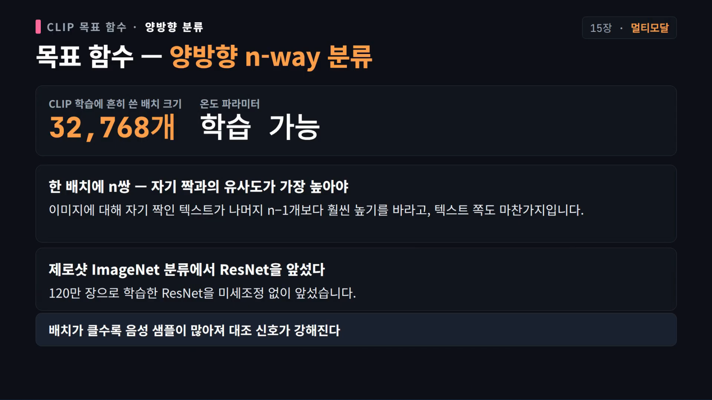
*[15장 · 1:54:27](https://youtu.be/3CGzbslfy0Y?t=6867) — 배치 32,768, 배치가 클수록 음성 샘플이 많아져 대조 신호가 강해진다.*

- 비전 트랜스포머 **ViT**: 14×14 패치 → 시각 토큰 → 1D 위치 인코딩 → 표준 인코더 → 어텐션 풀링. 구성은 **ViT-L/14 336px**, 텍스트 약 **6,300만** 파라미터.
- 성과: **120만 장으로 학습한 ResNet을 제로샷 ImageNet 분류에서 앞섰다.**
- 한계: 분류가 목표라 **OCR·개수 세기·공간 관계에 둔감**, 32k급 초대형 배치 요구, 소프트맥스가 배치 전체에 걸려 병렬화 어려움, 4억 쌍 데이터 미공개(오픈 재현은 LAION-5B).

### 15.3 SigLIP(2023, Google) — 손실 함수 하나만 바꿨다

배치 전체 소프트맥스 대신 **각 이미지-텍스트 쌍을 독립 이진 분류**로 판정(짝 +1, 나머지 −1, 시그모이드). 손실이 배치 크기와 분리되므로 **16,000 미만 배치에서 훨씬 낮고, 32,000에서 대등**. 병렬화도 쉬워 **TPU v3 256장 11일 → TPU v4 32장 5일**로 같은 수준 도달. 학습 데이터 WebLI는 수십억 쌍에서 **상위 10%**, **100개 언어**.

### 15.4 VLM — 인코더 + 어댑터 + LLM

표준 구조: 기성 CLIP/SigLIP을 **동결**한 비전 인코더 → **어댑터**가 시각 벡터를 언어 모델이 읽는 가짜 텍스트 토큰으로 번역 → LLM이 섞인 시퀀스를 받아 답변. 두 대형 모듈을 건드리지 않으므로 처음부터 학습하는 것보다 싸다.

| 모델 | 구성 | 특징 |
| --- | --- | --- |
| **LLaVA**(2023, MS+Wisconsin) | CLIP ViT-L/14 + 단층 선형 투영 + Vicuna | 그림 대화 데이터가 거의 없어 **GPT-4로 합성**(MS COCO 주석 묶어 프롬프트 → **158,000개**). 1단계 투영만 학습, 2단계 LLM 해제 |
| **LLaVA-1.5**(2024) | SigLIP + 2층 MLP + Qwen 72B | **AnyRes**: 전체 축소본 + 최대 9개의 336×336 조각 |
| **Qwen-VL**(2023) | OpenCLIP ViT-bigG + 단층 교차 어텐션 | 어떤 크기든 **256개 고정 토큰**으로 압축, `IMG`/`box`/`ref` 특수 토큰으로 검출 상자·이미지 간 대화 |
| **Qwen2-VL**(2024) | **6.75억** 비전 인코더 + **동적 해상도** + **M-RoPE** | 224 패치를 따로 인코딩 후 2×2 묶음 압축(그룹당 **66토큰**). M-RoPE는 위치를 **시간·높이·너비** 셋으로 분해. 비디오 초당 2프레임, **16,384토큰**까지 |
| **Qwen3-VL**(2025) | Qwen3(최대 235B-A22B, 256K 문맥), 하위 호환 인코더 | M-RoPE를 **시간·너비·높이 교차 배열**로, 비디오 타임스탬프를 실제 참조 가능한 토큰으로, **DeepStack**(인코더 여러 층 출력을 LLM 여러 층에 분산 주입), 긴 비디오가 손실을 지배하지 않게 **길이의 제곱근 역수** 손실 정규화, 사전학습 4 + 후학습 3 = **7단계** |

→ "이제 승부는 구조가 아니라 **데이터와 학습 절차, 손실 설계의 세부**에서 갈린다."

### 15.5 다른 길 — Chameleon(2024, Meta)

이미지와 텍스트를 **모두 이산 토큰**으로 취급하면 모델 전체가 표준 트랜스포머 하나로 통일된다. **VQ-VAE**로 512×512 이미지를 **1,024토큰**으로. 어댑터도 비전 인코더도 없이 다음 토큰 예측으로 학습.

그러나 학습이 **심각하게 불안정**했다 — 텍스트 토큰은 저엔트로피인데 이미지 토큰은 작은 패치의 색조차 모르는 고엔트로피. QK-Norm과 z-loss로 간신히 수렴했지만 이산화로 정보를 잃어 **OCR 같은 과제는 거의 쓸 수 없었다**. 결국 2022년 이후 생성의 승자는 확산 모델, **연속 인코더 + 트랜스포머 + 확산**의 조합이 최종 판도다.

---

## 16장 · 진짜 추론일까, 패턴 맞추기일까 — 확장 에세이 (2:00:09)

**한 줄 요지: 이 장은 결론이 아니라 질문이다(본문도 "아직 갱신 중"). 1부는 추론의 정체, 2부는 르쿤의 미래론이며, 후자는 업계 합의가 아니라 한 관점이다.**

### 16.1 1부 — 추론은 어디에서 오는가

- 이상한 장면: **9.169와 9.6 중 어느 쪽이 큰가**는 사람이 한눈에 아는데 모델은 한참 생각한다. 반대로 Claude가 **31단계**로 저명한 수학자가 오래 붙들던 미추측을 풀었다는 사례도 있다.
- **답 1 — 능력은 이미 사전학습 안에 있다**(Denny Zhou). 베이스 모델이 추론 없이 답하는 것은 능력이 없어서가 아니라 **매 단계 확률 최대 토큰만 고르는 탐욕 디코딩이 능력을 가리기 때문**. 증거는 **pass@k**: 적게 뽑으면 RL 모델이 앞서지만 많이 뽑으면 베이스가 따라잡고 어떤 과제에서는 역전한다.

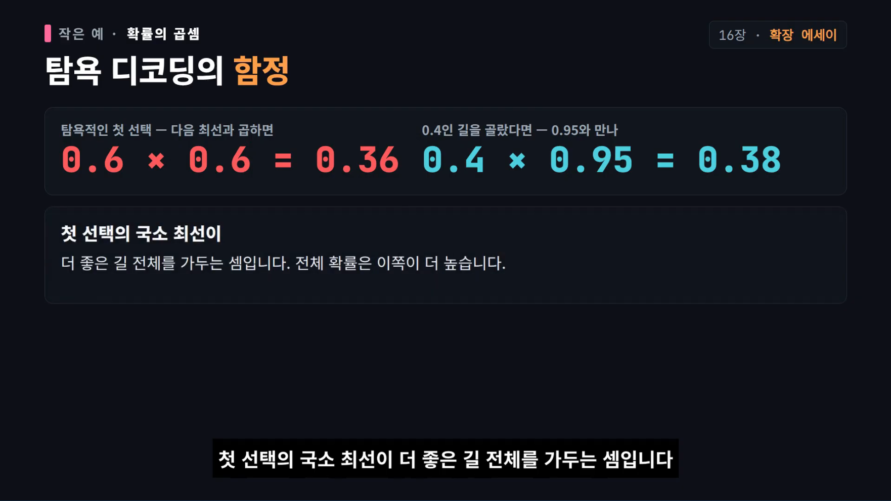
*[16장 · 2:01:57](https://youtu.be/3CGzbslfy0Y?t=7317) — 첫 토큰의 국소 최선(0.6×0.6=0.36)이 더 좋은 길 전체(0.4×0.95=0.38)를 가둔다.*

- 그래서 Zhou 팀은 미세조정 없이 **여러 경로를 뽑아 신뢰도 높은 답을 고르는 사고 사슬 디코딩**만으로 추론을 끌어냈다.
- **답 2 — 압축**. 교차 엔트로피를 낮추는 일은 정보 이론에서 **데이터를 가장 짧게 부호화하는 일**과 같다. 모든 문장을 외울 수는 없으니 모델은 통계 규칙을 추상 표상으로 압축해야 한다. Hinton의 가계도 실험에서도 은닉층이 개념을 여러 뉴런이 나눠 맡는 **분산 표상**으로 스스로 담아냈다. 결론: **추론은 암기와 일반화가 함께 만든 결과**이고, **후훈련은 새 지식을 넣기보다 잠든 능력을 깨우고 정렬하는 일**에 가깝다(분포 밖 과제에서 RL이 새 전략을 만든다는 반론도 있다).
- **CoT가 길다고 좋은 게 아니다.** 2025 베이징대 연구에서 사슬 길이와 정확도는 **역 U자** — 너무 길면 맥락이 희석돼 오히려 틀린다. 2026 구글의 **DTR**은 길이가 아니라 **깊이**(깊은 층까지 계산이 이어진 토큰의 비율)를 재자고 한다.
- 지식은 학습 시점에 멈춰 있으므로 최신성은 **검색·도구 호출**이라는 외부 기억으로 메운다. "검색 + 추론 > 추론만".
- 1부의 답: **추론은 어느 한 장치의 마법이 아니라 사전학습의 압축 + 후훈련의 깨우기 + 계산을 늘리는 노력이 겹친 결과**다.

### 16.2 2부 — 르쿤의 미래론 (업계 합의 아님)

- 르쿤은 LLM을 실패작이라 하지 않는다. **매일 쓰는 유용한 기술이지만 종점은 아니다.** 예: 새 차가 100 m 앞인데 "걸어가라"는 답은 그럴듯하지만, **씻을 것은 차**다 — 물리적 전제를 놓친다.
- 결핍 둘: **자기 행동의 결과를 예측하는 능력**, **여러 갈래를 탐색해 계획을 세우는 능력**. 이것이 가장 아프게 드러난 곳이 **VLA(시각-언어-행동) 모델** — 카메라 각도만 틀어도 성공률이 **95% → 30% 아래**로 떨어지고, 모델이 언어 지시를 상당 부분 무시하고 화면 단서로만 움직인다는 결과. "글자는 틀리면 다시 쓰면 되지만 로봇 동작은 되돌릴 수 없다." 단 창고 분류 같은 고정 환경에서는 지금도 쓸만하다는 균형도 잡는다.
- 대안: **세계 모델**. 핵심은 **픽셀을 그대로 예측하지 않는 것** — 물병을 밀면 넘어질지는 알아도 어느 방향인지는 픽셀 단위로 모른다. 그래서 **JEPA**(공동 임베딩 예측)는 의미만 남긴 **추상 표상 공간**에서 다음 상태를 예측한다. 2026 **LeWorldModel**은 파라미터 **1,500만 개**, 손실 둘·조절값 하나로 밀기 과제 **96% 성공**, 최대 **50배 빠른 계획**(아직 짧은 계획만 가능한 초기 단계).
- JEPA의 최대 난제는 **표상 붕괴** — 모든 입력을 같은 벡터로 보내면 예측은 늘 맞고 손실은 줄지만 아무것도 배우지 못한 컨닝. 해법은 대조 학습·증류·명시적 정규화 세 갈래이고, 르쿤이 가장 유망하게 보는 것은 **SIGReg**(표상 분포를 정규분포 모양으로 강제). 증류에 대한 그의 평가는 솔직하다 — "우리는 이 방법을 좋아하지 않지만 동작은 한다."
- 안전: **LLM은 본질적으로 안전하지 않고** 환각을 막을 내장 장치가 없어 지금 틀 안에서는 근본적으로 고칠 수 없다. 코드 에이전트가 하드디스크를 지운 실제 사례도 본문에 실려 있다. RLHF 같은 정렬은 **위험한 답의 확률을 낮추는 부드러운 제약**일 뿐, 대안은 **주도 안전(guard-railed safety)** — 비용 함수 안에 규정을 넣어 계획 단계에서 어기는 행동을 아예 고를 수 없게 하고, 실패하면 비용 함수나 세계 모델이 틀린 것이니 고칠 곳을 찾을 수 있게 한다.
- 정보 주권: 모두가 소수의 AI 비서로만 세상을 보면 만든 곳의 언어와 가치관이 모두의 정보 식단을 정한다. 르쿤의 **태피스트리(Tapestry)**는 연합 학습을 나라·기관 단위로 키운 구상 — 데이터는 각자 품고 **파라미터만** 나눈다.
- 르쿤의 미래는 3층: **LLM = 언어·지식 인터페이스 / 세계 모델 = 이해·계획 / 설정자 = 목표·안전**. 전환의 필요성은 **2027년 초면 자명해질 것**이나 해법이 그때 완성된다는 뜻은 아니라고 선을 긋는다.
- 시리즈를 닫는 질문: **"지능이란 다음 단어를 잘 맞히는 것인가, 아니면 자기 행동의 결과를 예측하는 것인가?"**

---

## 부록 A — 요구 토픽이 영상 어디에 있는가

| 요구 토픽 | 위치 | 영상이 다루는 깊이 |
| --- | --- | --- |
| BPE · 토크나이저 | 2장 전체 | ★★★ (알고리즘·전처리·다국어·실물 분석·과제 산출물까지) |
| 임베딩 | 2장(입구), 4장(토큰→벡터 lookup, 위치 임베딩은 RoPE로 대체), 15장(시각·텍스트 공동 임베딩) | ★☆ (별도 장 없음. 임베딩 tying·스케일링은 μP 문맥에서만 스침) |
| Self-Attention / Multi-Head | 4장(원 논문 8헤드), 6장(FlashAttention), 5장(선형·희소) | ★★☆ (수식 유도는 없고 구조·비용·최적화 중심) |
| RoPE | 4장 (23:57 부근) | ★★ (회전으로 상대 거리, 차원별 주파수) |
| RMSNorm / LayerNorm / Pre-Norm | 4장 | ★★ (평균 제거, 편향 제거, 실측 3.5→3.68 스텝) |
| FFN / SwiGLU | 4장 (게이트 구조, 2.66× 관습, 반례) | ★★ |
| KV Cache | 10장 (1:13:07) | ★★★ (프리필/디코드, 크기식, 연산 강도) |
| 사전학습 | 11장(데이터), 13장(GPT-1→3, 규모) | ★★★ |
| SFT | 13장 (Alpaca/ChatML, s1 사례, 환각 함정) | ★★★ |
| LoRA / 파인튜닝 | **5장 Kimi K2의 LoRA 샤딩 언급뿐** | ☆ (LoRA 학습법·랭크·QLoRA는 이 합본에 없음. 13장은 full SFT와 선호 학습 중심) |
| DPO / RLHF / PPO | 13장(RLHF 3단계·PPO 클리핑·DPO), 14장(PPO→GRPO) | ★★★ |
| 추론 최적화 | 10장 전체 + 6장(PagedAttention) + 7장(커널) | ★★★ |

> 브리프의 예시 목록 중 **LoRA 가중치 분해**는 이 영상에 해당 구간이 없다. 대신 같은 축의 **GRPO/RLVR(14장)**과 **MoE 세분화(5장)**가 깊게 들어가 있으므로, LoRA는 별도 자료로 보충하는 것이 맞다.

---

## 부록 B — 영상이 제시한 수치 모음(자막 기준)

| 수치 | 값 | 위치 |
| --- | --- | --- |
| 70B × 15T 학습 계산량 | 6.3e24 FLOPs | 3장 |
| H100 BF16 피크 / 밀집 실효 | 1,979 / 약 990 TFLOPS | 3장 |
| MFU 가정 | 30~60%(50% 사용) | 3장 |
| 1024×H100 학습 기간 | 약 146일 | 3장 |
| 학습 메모리/파라미터 | 약 16 B | 3장, 8장 |
| H100 연산 강도 | 약 295 FLOP/byte | 3장 |
| RMSNorm 속도 | 3.5 → 3.68 스텝/s | 4장 |
| 게이트 FFN 확장비 | 2.66×(ReLU 4×) | 4장 |
| AdamW(과제1) | β(0.9, 0.95), lr 3e-4, min 3e-5, warmup 10% | 4장 |
| DeepSeekMoE 조합 수 | 120 vs 4,426,165,368 | 5장 |
| FlashAttention V2 | V1 대비 1.7~2.0×, 표준 대비 8~10× | 6장 |
| FlashAttention V3 | SM 활용 60%→80%+, FP8로 1.5~2× | 6장 |
| PagedAttention 낭비 | 1,748토큰 → 4토큰 | 6장 |
| GELU 커널 | 8.1 ms → 1.1 ms(내장), CUDA 1.8 ms, Triton 1.848 ms, compile 1.47 ms | 7장 |
| 점유율 예시 | 18.75%(12/64 워프) | 7장 |
| ZeRO 메모리(7.5B·64) | 120 → 31.4 → 16.6 → 1.9 GB | 8장 |
| FSDP | 통신 3×, 손실 10~20% | 8장 |
| 8×80GB 수용 | 6B → 약 50B(ZeRO-3) | 8장 |
| 텐서 병렬 손실 | 8대 10~12%, 16대 42%, 32대 +65% | 8장 |
| 스케일링 지수 | MT −0.13, 음성 −0.3, LM −0.095 | 9장 |
| 에포크 반복 한계 | 4까지 동등, 40 부근 평평 | 9장 |
| Kaplan / Chinchilla | 0.73·0.27 / 0.5·0.5(20 tok/param) | 9장 |
| 토큰/파라미터 | GPT-3 2×, Llama3 70B 215×, Mistral 7B 110× | 9장 |
| μP 전이 | lr 0.006, init 0.08, emb 10 | 9장 |
| 추론 캐시(간이) | 토큰당 3,200 B(25층·128·16헤드) | 10장 |
| 데이터 규모 | OLMo 2 3.9T, Qwen3 36T | 11장 |
| poisoning | 악성 문서 250개로 백도어 | 11장 |
| 벤치마크 | GPQA 80.3%, HLE 38.3%, Arena 1,492, IFEval 0.951 | 12장 |
| C-Eval 실측 | Qwen2.5-0.5B 1,346문항 CPU 5분 → 0.5134 | 12장 |
| s1 SFT | 1,000샘플·16×H100·26분·약 50달러 | 13장 |
| 라벨 노이즈 | 1% → F1 −2~5%, 20% 초과 시 찍기 이하 | 13장 |
| InstructGPT 주석 | 약 40명, 질문당 약 1분 | 13장 |
| GRPO | G=8, 200스텝, lr 1e-5, clip 0.2 | 14장 |
| R1 후학습 | 80만(추론 60만+비추론 20만) | 14장 |
| CLIP | 4억 쌍, 배치 32,768, ViT-L/14 336 | 15장 |
| SigLIP 학습 | TPU v4 32장 5일(vs v3 256장 11일) | 15장 |
| Qwen2-VL | 6.75억 인코더, 그룹당 66토큰, 16,384토큰 | 15장 |
| LeWorldModel | 1,500만 파라미터, 96% 성공, 50배 빠른 계획 | 16장 |

---

## 부록 C — 영상이 스스로 지적한 "원문과 다른 점"

1. **10장의 과제 연결 표기 오류** — 개요표는 과제 6이라 하지만 실제 과제 6은 12장(평가)에 붙고, 10장 본문에 과제 언급이 없다.
2. **14장 본문 수식에는 KL 항, 과제 5 핸드아웃은 KL 미포함** — 실습 재현 시 이 차이를 먼저 확인해야 한다.
3. **WordPiece 점수식은 구글 공식이 아니라 HuggingFace 원리 소개의 근사식**.
4. **소프트 클리핑(상한 30)은 반증 사례가 있음** — 기준 ppl 11.19보다 나빠졌다.
5. **R1-Zero의 "아하 모먼트"는 과장됐을 수 있다** — 베이스 모델도 같은 현상을 보였다.
6. **1장은 본문이 없는 준비 장**(W&B 가이드만), **5장은 특정 과제와 연결되지 않음**, **3장도 과제 연결 없음**.

---

## 부록 D — 자동 자막 오인식 교정표(주요 항목)

| 자막 표기 | 실제 | 자막 표기 | 실제 |
| --- | --- | --- | --- |
| 딥식 / 딥 시크 | DeepSeek | 퀸 / Q& | Qwen |
| 로프 / 로프 | RoPE | 스위글루 / 스위질 | SwiGLU |
| 프리놈 / 포스트놈 | Pre-Norm / Post-Norm | 레이어 놈 / RMS 놈 | LayerNorm / RMSNorm |
| 제로 / FSDP | ZeRO / FSDP | 캐플런 / 친칠라 | Kaplan / Chinchilla |
| 아이소플롭스 | IsoFLOPs | 뮤피 | μP |
| 원 대시 | o1 | 뎁시크 v3 | DeepSeek-V3 |
| 톨치 점 컴파일 | `torch.compile` | 트리톤 | Triton |
| 플래시 어텐션 / 페이지드 | FlashAttention / PagedAttention | 켄 에렘 | KenLM |
| 민 해시 / LSH | MinHash / LSH | 블룸 필터 | Bloom filter |
| 클립 / 시클립 | CLIP / SigLIP | 라바 | LLaVA |
| 카멜레온 | Chameleon | JPA / 라월드 | JEPA / LeWorldModel |
| 시그랙 | SIGReg | 얀 르칸 | Yann LeCun |
| 소고 실험 | 소거(ablation) 실험 | 하이브리드 어텐션 | hybrid attention |
| 슈퍼 글루 | SuperGLUE | 헬름 | HELM |

---

## 참고 링크

- 영상: <https://youtu.be/3CGzbslfy0Y>
- 채널: <https://www.youtube.com/@codedeck-kr>
- 원 과정(Diy-LLM, DataWhale): Stanford CS336 「Language Modeling from Scratch」의 중국어 학습자용 재구성 — 장별 텍스트 본문 + 코드 노트북 + 과제 핸드아웃(CC BY-NC-SA)
- 이 저장소의 자매 문서: [Agentic AI 엔지니어 12단계](../agentic-ai/2026-11-11-agentic-ai-engineer-12-steps.md)
